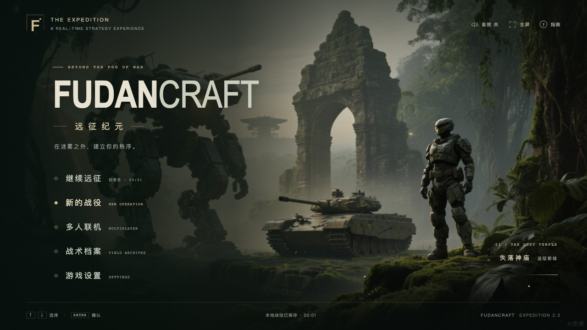
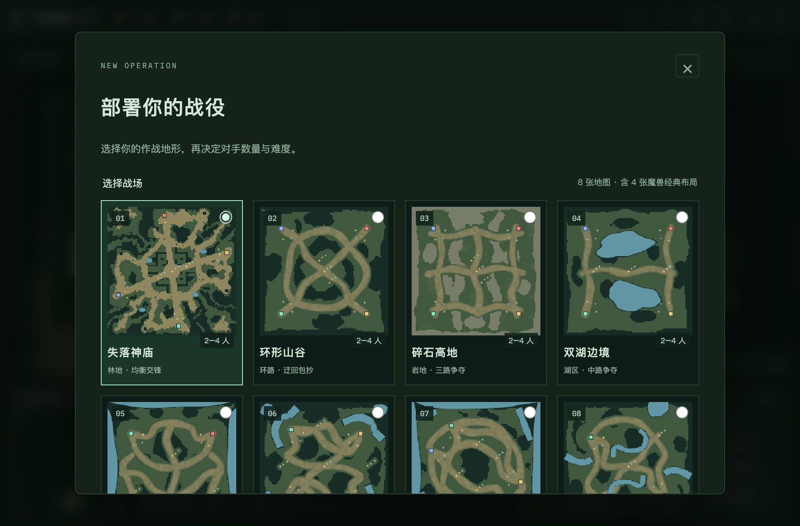

# FudanCraft · The Expedition 2.3

[中文](README.md) | **English**

[Play online (GitHub Pages)](https://pj-fdu.github.io/fudan-craft-web/) · [Pages deployment guide](docs/GITHUB_PAGES.md)

A **Node.js + TypeScript + Three.js** RTS remake based on [PJ-FDU/fudancraft](https://github.com/PJ-FDU/fudancraft), with a WebSocket server edition and a static WebRTC P2P edition. Gather resources, build a base, research upgrades and command your army. Play single-player operations, 2–4-player free-for-all battles, or co-op against AI with 1–2 human players.



## Four factions

Choose your faction and the AI factions in **New operation**, or select a faction for your seat in a multiplayer lobby. The Industrial Federation uses power and factory modules; the Brood Symbiosis shares production through hatcheries; the Stellar Council relies on node coverage; the Relay Alliance uses mobile assembly stations and fixed supply towers.

Select a core support unit to see its energy, cooldowns and the number of eligible casters. On desktop, **U / Y** select the first two active abilities in the current group. On touchscreens, tap an ability, then its unit or ground target. Relay assembly stations can pack up, move and deploy. Older saves retain their original legacy rules.

New faction games use weighted population: a Command Center provides 20 capacity, and each completed faction supply building or unit adds 8, up to a capacity of 120. Legacy rules retain an 80-mobile-unit limit. The legacy unit, building and technology tables below describe that older ruleset; the source and in-game tech tree define the complete faction rosters and prerequisites.

The values in the [four-faction design and matchup guide](docs/four-race-ability-design/four-race-ability-design.md) are design baselines. Actual opening rosters, production and ability parameters are defined in [faction rules](src/game/races.ts), [unit and building stats](src/game/types.ts), and the [ability catalog](src/game/abilities.ts). Costs, native shields and research times are initial values for match tuning.

## Getting started

Requires Node.js 22 or newer.

### Server edition (WebSocket)

```bash
npm ci
npm run dev
```

Open [http://localhost:4320](http://localhost:4320). The home page is a separate expedition menu. Choose **New operation**, set the battle size, AI difficulty and one of four strategy styles, then enter **Choose battlefield** to select one of eight maps and deploy. In multiplayer, the host chooses the map before starting. Two human co-op players need a four-player map.

Dependencies come from the public npm registry and are pinned by `package-lock.json`. The cover artwork and interface fonts load locally. See [interface fonts](docs/FONTS.md) for sources and licenses.

```bash
npm run build
npm start
```

Production serves the game and `/ws` on the same port. Development and production listen on `0.0.0.0:4320` by default and print local and LAN IPv4 addresses at startup. Use `PORT=8080 npm start` to change the port, or `LISTEN_HOST` to choose the listening address.

For internet multiplayer, see [public deployment](#public-deployment). LAN players can use the address printed at startup.

### GitHub Pages edition (WebRTC P2P)

Open the [online game](https://pj-fdu.github.io/fudan-craft-web/) to play immediately. To deploy your own copy, build the static edition, which needs no Node server and uses Metered for WebRTC P2P multiplayer:

```bash
cp .env.pages.example .env.pages.local
# Set VITE_METERED_PUBLISHABLE_KEY to your Metered Realtime pk_live_ public key.
npm run build:pages
npm run preview:pages
```

The output is `dist-pages/`; preview it at [http://localhost:4330](http://localhost:4330). Use `npm run dev:pages` for development. The host creates a room and copies the complete invitation link. Friends open the link, enter their callsign and join; the host then selects a map and starts. Both free-for-all and co-op against AI are supported. Keep the host page open: reloading or leaving ends the room. While the room remains active, guests can recover their seats within 120 seconds of disconnecting. See [GitHub Pages P2P setup](docs/GITHUB_PAGES.md) for configuration, deployment workflows and runtime limits.

### Validation and performance

Run `npm run check:release` before a release. It runs all tests, the server build, the Pages build, and checks for repository subpaths, public assets and WebRTC modules. Configure the public key above before building Pages.

Settings offer Automatic, Quality and Power saving modes. Mobile controls support saving, recalling and locating groups 1–3, locating idle workers and filtering selected unit types. Match menus and post-game screens show economic and combat statistics and export JSON. See the [seven-improvement acceptance record](docs/IMPROVEMENTS.md) for source references and verification, and run `npm run benchmark` to reproduce the [balance benchmark](docs/benchmarks/balance.md).

## Eight battlefields

All eight maps use a 512 × 512 grid for new games, with 32 world pixels per tile. Their area is four times the previous 256 × 256 grid; units and buildings keep their original tile footprints. Lost Temple preserves its woodland road network. Ring Valley favors outer-ring flanking, Shattered Highlands contests three lanes and chokepoints, and Twin Lakes centers on a corridor and lakeside routes. Echo Isles (EI), Twisted Meadows (TM), Turtle Rock (TR) and Terenas Stand (TS) draw on classic layouts. Forests combine individually harvestable trees, clearings and paths; each starting area has nearby outpost gold and oil.

Map selection shows previews of the actual terrain. New operations use the latest terrain; saves record the map and terrain revision so existing games retain their layout. Older v2 saves without map fields are treated as Lost Temple. See [map parameters and verification](docs/FOUR_MAPS.md) and the [terrain comparison](docs/map-naturalization-comparison.png).



## 3D battlefield

The battlefield uses Three.js and requires WebGL 2. All four faction rosters and nature meshes load from Blender-exported GLBs, with editable rigs, Cycles PBR atlases, branching trees, a tessellated ground mesh and shoreline-aware wave surfaces. See the [Blender workflow](docs/BLENDER_GAME.md) for rebuilding, editing and verification. Aircraft fly above ground and shells follow airborne arcs. Terrain blocking, building footprints and sight use the existing map and combat rules. v2 saves remain readable.

The 78 faction models also have refined high-poly surfaces, independent UV regions, high-to-low tangent normal and AO projection, and dedicated albedo/ORM textures. Armor, chitin, keratin and canvas use separate shape and material rules. See the [sculpting and rebuilding workflow](docs/BLENDER_SCULPT.md).

The Industrial Federation harvester now has a dedicated sloped cab, pneumatic tires and hubs, twin hydraulic arms, telescoping guides and articulated gripping tines, with independent 2K PBR maps and an editable Blender project. AI-generated texture samples combine with geometry-based masks for chipped paint, bolt rust and muddy tires, plus actual dents in the fender and loader arm. See the [weathering comparison](artifacts/worker-hero/battlewear-comparison.png), [reference comparison](artifacts/worker-hero/reference-comparison.png), [actual game gallery](artifacts/worker-hero/game-worker-idle.png) and [rebuild details](docs/WORKER_HERO.md). Run `npm run assets:worker` to rebuild this vehicle independently.

The Ghost Sniper has a dedicated high/low model and 2K PBR maps, with a curved waist and chest, both hands tracking rifle contact points, and the eye aligned to the scope. Eight cape bones provide independent wind and movement sway. Its precision rifle includes a bolt handle, open bore and vents, segmented scope and adjustable stock. See the [revision comparison](artifacts/sniper-hero/revision-comparison.png), [grip side view](artifacts/sniper-hero/grip-side-detail.png), [cape animation](artifacts/sniper-hero/cape-motion.gif), [ray-traced aim](artifacts/sniper-hero/cinematic-aim.png) and [rebuild notes](docs/SNIPER_HERO.md). Run `npm run assets:sniper` to rebuild it independently.

Models have rounded armor, smooth surfaces and layered mechanical structures. Vehicles include track segments, wheel bolts, cooling louvers and access panels; buildings include ladders, pipe flanges, railings and rooftop equipment. Original atlases provide wear, with separate roughness and metalness for metal, paint, rubber, fabric and glass, plus subtle bump detail.

Battlefield lighting combines ACES, baked sky reflections, warm and cool fill, and directional shadows with screen-space diffuse bounce and dynamic reflections driven by actual texture normals, albedo, roughness and metalness. Both sources and receivers respect fog of war. Basic, Balanced and Fine preferences remain subject to the automatic performance ceiling. The model gallery adds optional cinematic tracing: motion uses a raster preview without path-sampling noise. Once animation and camera movement stop, WebGPU traces the complete model's triangle BVH with six path bounces and area-light soft shadows. The traced image appears only after every pixel reaches 256 samples at full resolution and static denoising finishes. Preparation keeps the raster preview visible with a progress indicator; motion immediately restores it. Lighting differs between the two modes. See the [moving and paused views](artifacts/cinematic-hybrid/comparison.png), [actual rendering comparison](artifacts/worker-hero/cinematic-comparison.png), [current battlefield](artifacts/worker-hero/cinematic-battle-high.png) and [implementation and budgets](docs/3D_RENDERING.md).

The nine legacy mobile unit types use skeletal skinning and part textures. Infantry and walkers have knee, ankle, shoulder and elbow joints, with gait driven by actual distance traveled. Vehicles turn their wheels, turrets and arms; aircraft bank while turning. Battles render at up to 60 FPS, or 24 FPS when paused. The home page neither renders nor simulates the battlefield, and dynamic shadows update at most 30 times per second.

All four factions share surface weathering: rust, chipped paint, oil and bullet marks on metal; scratches on ceramic and carapace; dust on fabric and rubber. Faction colors retain wear. Weathering moves with model parts and uses the existing batching and textures. See the [four-faction in-game preview](docs/faction-materials/weathering-preview.jpg).

The default camera pitch is about 38°. Press **Z / C** or use the rotation buttons on the zoom bar to rotate by 30°. Wheel zoom remains anchored to the pointer. Box selection uses on-screen unit positions, and the minimap frame rotates with the view. Portraits, the animation codex, HUD and minimap remain two-dimensional information displays. Missing WebGL 2 produces a startup error; a lost graphics context waits for browser recovery.

## Expedition main menu

The home page uses an original temple, walker and tank scene. At widths up to 900 CSS pixels it uses an approximately 37 KB WebP cover and disables camera easing and floating particles. Language, sound and fullscreen controls are ready with the home page. Game code loads when an operation, multiplayer screen or codex is opened. Local saves and multiplayer seats are checked after the first screen is shown. Battlefield atlases and the 3D scene load on entry to battle. See [mobile first-screen measurements](docs/IMPROVEMENTS.md#移动端首屏).

**Continue expedition** uses the same validation as normal loading and only enables for a valid local save, showing its map and elapsed time. The single-player **Save and return to main menu** action saves progress. In server multiplayer, **Leave operation and return to main menu** leaves the room while the server continues the simulation. The codex, settings, guide, audio and fullscreen are available from home. **↑ / ↓** select a menu item and **Enter** confirms; home does not react to production, pause or console shortcuts.

See [desktop](docs/title-screen-wide.jpg), [mobile](docs/title-screen-mobile.jpg), and [landscape](docs/title-screen-landscape.jpg) previews.

Operation settings and map selection share the cinematic background. The first screen sets player count and difficulty; the second shows eight maps, a full terrain preview, resource and spawn legends, and a deployment summary. Going back preserves candidate settings. For three- or four-player operations, EI and TS are marked **Two players only** and disabled. An incompatible earlier selection switches to a compatible map with an explanation. **Esc** goes back; **Enter** advances or deploys. Canceling settings opened during battle restores the prior paused or running state.

`src/game/operation-menu.ts` manages candidate settings, `src/main.ts` starts games, and `src/operation-menu.css` styles the menus. Large previews and lobby thumbnails share the terrain renderer in `src/game/map-picker.ts`. See [operation settings](docs/operation-settings-desktop.jpg), [map selection](docs/operation-maps-desktop.jpg), and [mobile map selection](docs/operation-maps-mobile.jpg).

## Audio and communications

Audio includes an original expedition theme, exploration and combat music, wind and lake ambience, and firing, impact, explosion, healing and interface effects. The nine legacy building types have selection sounds and ambient audio: factory hammering, lumber sawing and hangar engines respond to distance and actual production or construction. The nine legacy mobile unit types and command announcements use Chinese and English Qwen3-TTS recordings. Selection and movement each rotate between two lines with a shared five-second interval; harvesters have dedicated gathering and repair lines. The asset set contains 176 MP3 files.

Playback starts after the first click or keypress. The top-right sound button mutes audio. Home settings and battle controls offer five volume channels, communication subtitles and voice previews, with preferences saved in the browser. Voice lines duck music; background tabs suspend audio. Combat sounds follow authoritative visible events and distance attenuation. Pausing, loading and returning home do not replay old combat sounds.

The home **EN / 中文** control and **Language and voice** setting switch the entire interface and recordings together, preserving the current battle and saving the preference. Menus, map descriptions, unit, building and resource details, tooltips, the animation codex and subtitles support both languages. See [localization implementation and coverage](docs/LOCALIZATION.md).

`src/game/audio-catalog.ts` is the source of truth for the asset list and bilingual lines. Run `npm run audio:generate` to rebuild music and effects; use the Qwen3-TTS scripts to rebuild voices. Players play the MP3 files shipped with the site. See the [audio guide](docs/audio.md).

## Current control layout

Desktop has a metal top toolbar for resources, power supply and demand, match time, pause, panels, fullscreen, menus and the guide. Mobile uses a separate layout: a 48 px top bar keeps resources, pause and menu; the bottom holds the minimap, an expandable selection summary and five quick commands with transparent backgrounds. Production, construction and research expand on demand. This layout activates below 800 px or when the primary pointer is touch, with portrait, landscape and safe-area support. Shared panels move between layouts without duplicating simulation or state.

The bottom console follows Warcraft III / StarCraft-style instrument sections: dark metal housing, copper trim, recessed buttons and cyan status lights. The minimap sits on the left, a large unit portrait and status in the center, and commands with a nine-icon grid on the right. The side panels are taller than the center. Desktop height scales to about 30% of the viewport within 188–246 px; at 1280 × 720, the sides are about 216 px and the center 198 px.

Multiple selection shows group thumbnails. Click to select one unit, or **Shift-click** to remove it. **Locate** moves the camera to the selection. Single selection shows health, damage, range, speed or cargo; multiple selection shows composition and combined health. Health bars are segmented and turn reddish brown below 30%. A construction site or its worker shows actual progress and whether construction is active, positioning or waiting to resume. Production buildings show their current task, progress and remaining time, with a pause label when power is insufficient. Population, worker count and the cancelable global queue remain at the bottom center.

Building, resource and unit rings share thin ground-level outlines; models occlude the rear arcs, and attack ranges also sit on the ground. Select resources to see remaining amounts. Clicking a resource with workers selected still orders gathering. **Esc** clears resource selection.

Production, construction and research use matching three-column icon grids. Training, resource buildings and combat commands show shortcuts. Locked icons are gray and show prerequisites; hover or keyboard focus reveals descriptions, costs, times and reasons for unavailability. Expanding with **B** shows details directly. Selecting a building disables mobile-unit orders. Damaged buildings can assign nearby workers with **Repair**. Desktop styling lives in `src/battle-hud.css`; touch layout and behavior are in `src/touch-hud.css` and `src/game/touch-hud.ts`.

On touchscreens, double-tap a unit to select its type in view and triple-tap to select all friendly mobile units, including workers. Hold for 420 ms and drag to box-select. Drag immediately with one finger to pan, or use two fingers to pan and zoom. Selected workers gather from resources, repair damaged buildings or resume unfinished construction when tapped. The page intercepts shortcut, Ctrl / Cmd-wheel, double-tap and pinch page zoom while retaining game-camera zoom; browser menus and system-forced zoom remain outside page control.

See [gameplay parameters and verification](docs/GAMEPLAY_RULES.md) for worker repair, shared values and AI rules. AI protects harvesting lines, repairs, rebuilds, scouts, keeps defenders, retreats wounded units and counters visible enemy composition. Difficulty changes strategy without adding resources or damage.

## 2.3 movement and combat synchronization

- Ground units use swept circular collision checks, local avoidance and replanning around congestion. Formation destination spacing is 64 world pixels; gathering, delivery and construction have separate work and waiting positions. Idle allies can yield, and units overlapping or inside buildings in old saves try to recover to walkable positions.
- Routes avoid crowded positions. Allies queue or retreat to yield in narrow passages. Formations use staggered destinations and try nearby reachable ground when a target is occupied.
- Instant-hit weapons play their windup before synchronizing tracers and damage. Tank and artillery shells apply area damage on arrival. Launched shells persist after the shooter dies. Move and stop orders can interrupt attacks before launch.
- Gait follows actual movement and settles when stopped. Infantry, harvesters and tanks have subtle start, stop and recoil motion; vehicles smoothly turn on departure and while aiming. The animation codex uses actual action timing. This update reuses existing atlases without new art keyframes.
- Authoritative simulation provides enemy maximum health, fixing health-bar ratios after armor upgrades. The server still filters enemy technology and projectile damage payloads.
- v2 saves remain compatible and preserve pending attacks and airborne projectiles. See [movement and combat implementation](docs/MOTION_COMBAT.md).

## 2.2 animated battlefield

This update generated 16 assets with the built-in image generator, totaling **876 animation and stage frames**. See [animation assets](docs/ANIMATION_ART.md) for the actual prompts and atlas layout.

- The nine legacy mobile unit types retain eight directions, each with two idle, four move, two attack, healing or work, and two death frames: 720 frames in total. Gathering and construction share the harvesting-arm work frames and follow actual work state.
- Pines, oaks, birches and shrubs use continuous wind deformation over roughly 12 seconds. Only crowns sway; roots and lower trunks remain fixed. Resource forests use the same wind motion.
- Each of nine legacy building types has four construction stages, four damage levels and four production frames. Production follows actual queues and power. Construction adds welding smoke, heavy damage adds fire and smoke, and completed production or research adds deployment effects.
- Grass and soil use separate 1254 × 1254 textures. Terrain chunks follow viewport, zoom and device pixel ratio, up to four pixels per world pixel with a 64 MiB cache. Zooming no longer samples a single fixed 4096 × 4096 map.
- Dead units leave the simulation immediately but briefly retain a fallen body or wreck and fade out. Multiplayer animation events are filtered by event time and current sight.

Open **Battle menu → Animation codex** to inspect unit types and directions, step through frames, and view building stages, trees and terrain. The menu can disable unit and environment animation. v2 saves from 2.0 and 2.1 remain compatible, with missing animation data initialized on load.

## 2.1 visibility and controls

Version 2.1 introduced a 44 px top bar and a translucent floating console so the canvas could fill the viewport. The bottom console now uses the classic RTS layout described above. Dispatch expands on demand and objectives start collapsed. **V** hides the console and **B** toggles dispatch. Large information panels and minimum page heights no longer push the game off-screen.

Click fullscreen or press **F** to use the browser Fullscreen API. When browser permissions or embedded previews prevent it, the game enters an immersive layout with an explanation. The exit button or **F** restores the layout; **Esc** also exits native fullscreen.

- Middle-button or right-button drag, or **Space + left-button drag**, grabs and pans the map. A right-click still orders units; dragging beyond the threshold does not issue an accidental move.
- The wheel smoothly zooms around the world point under the pointer. **Shift + wheel** pans horizontally and **Alt + wheel** pans. Trackpad mode makes two-finger scrolling pan while pinch still zooms.
- On touchscreens, one finger pans; two fingers pan and zoom together. Lifting fingers does not issue unintended orders.
- Tap **Space** to return to base. Releasing it after a drag does not jump back.
- A shared camera handles map bounds, resizing and fullscreen; unit positions use render interpolation.

The nine legacy mobile unit types have eight independent views each, totaling 72 frames. Direction follows movement, gathering, construction or attacks; shortest-turn interpolation and hysteresis reduce flicker. See [directional assets and actual prompts](docs/DIRECTIONAL_ART.md). Version 2.1 continues to use v2 saves compatible with 2.0.

## Resources and harvesting

Three resources are tracked independently, with **no passive income**:

| Resource | Use | Gathering requirements |
| --- | --- | --- |
| Gold | Units, buildings and research | Harvester |
| Wood | Materials for buildings, units and technology | Harvester; Lumber Mill improves efficiency |
| Oil | Armor, aviation and advanced technology | Completed nearby Refinery and an Oil Well on an oil deposit |

New games start with 1,500 gold, 600 wood and 0 oil. A legacy opening has a Command Center, Power Plant, Barracks, three Harvesters, two Riflemen and one Scout Buggy. Faction games use their own production buildings, utility facilities and opening units; see [faction rosters](src/game/races.ts) and the [opening implementation](src/game/engine.ts). Harvesters automatically begin gathering nearby gold and wood. Vehicle Works requires 80 oil. Old saves retain their oil extraction rules and terrain revision.

Select a Harvester and right-click gold or trees to assign it. Base gathering speed is 20 per second and cargo capacity is 100. Full workers prefer the reachable delivery point with the shortest estimated travel time. Command Centers and Lumber Mills receive gold and wood; Refineries also receive gold. **Cargo enters inventory only on delivery.** Select a gold deposit to inspect working and queued vehicles. After the final gold delivery, workers look for an explored, reachable deposit within 1,200 world pixels of the depleted one. Without a suitable target, they wait at the delivery point.

Build a Refinery near an oil deposit. Placement previews show the 14-tile pipeline radius and connectable deposits. Once completed, build an Oil Well on a deposit within coverage. It costs 120 gold and 50 wood, takes six seconds to construct, and sends 14 oil per second through a visible pipeline to the nearest eligible friendly Refinery. If that Refinery is destroyed, the well reconnects to another completed Refinery in range or pauses if none is available.

Each side's main deposits contain 10,000 gold and 2,600 oil. Nearby starting forests contain 24 trees totaling 7,200 wood. Pines, oaks and birches yield 300 wood each. Felled trees leave stumps and free their footprint; workers harvest inward from reachable forest edges and fill their remaining cargo before delivery. Water, rocks and map edges remain blocked. Outposts contain 4,500 gold and 1,500 oil; distant expansions have 6,000 gold and 1,800 oil, and the contested central gold deposit has 9,000. Harvesters can be attacked, so protecting supply lines matters.

Twin Lakes and Ring Valley enable the outpost pilot. The minimap marks explored outpost gold and oil with diamonds and shows estimated depletion times for active friendly wells. Battlefield supply notices can locate their target, and post-game statistics record key events. Pilot AI scouts outposts, escorts construction and prioritizes discovered frontline supply facilities. See [outpost pilot results and reproduction commands](docs/GAMEPLAY_RULES.md#前哨试点).

See [resource rules](docs/RESOURCE_ECONOMY.md) for total map stocks, distribution constraints, save compatibility and fairness regression checks.

## Buildings and progression

Choose a building under **Base construction**, then click visible empty ground. The game prefers a selected Harvester or assigns another available one. Press **T** or click **Rotate building** to rotate by 90°; footprint previews and blocked tiles rotate together. Green means valid placement; red indicates terrain, sight or spacing restrictions. **Esc / right-click** cancels placement.

Construction requires a Harvester to arrive and work. To resume interrupted construction, select a worker and right-click the unfinished building.

The following route describes legacy rules. Each faction has its own production buildings, supply mechanics and unlock requirements; inspect the current faction's in-game tech tree.

| Building | Role and prerequisites |
| --- | --- |
| Command Center | Trains Harvesters and receives resources; losing it eliminates the player |
| Power Plant | Supplies 60 power; requires a Command Center |
| Barracks | Riflemen, Field Medics and Ghost Snipers; requires a Power Plant |
| Lumber Mill | +50% wood gathering efficiency; receives wood and gold |
| Refinery | Processes oil from wells within 14 tiles; receives gold; requires Barracks |
| Oil Well | Built on a deposit with remaining oil; pipes oil automatically; requires a nearby completed friendly Refinery |
| Vehicle Works | Scout Buggies, tanks, Howitzers and walkers; requires Barracks |
| Research Lab | Five technologies and Field Medic access; requires Barracks |
| Airfield | Aircraft production; requires Vehicle Works |
| Sentinel | Automatic ground and air defense; requires Barracks |

Buildings have independent queues: tasks run sequentially in one building and in parallel across buildings. In legacy rules and the Industrial Federation, insufficient power pauses military production and research; Command Centers can still train Harvesters. Cancel queued tasks for a full refund. Destroyed production buildings refund unfinished tasks. Each side can have at most 35 buildings. Legacy rules allow 80 mobile units; faction games use the population capacity and weights described above.

## Technology

These five legacy technologies are queued at the Research Lab, cost resources and take time. Faction games add stage upgrades, dedicated research buildings and faction technologies; the current faction's tech tree determines available research.

| Technology | Effect | Prerequisites |
| --- | --- | --- |
| Precision Weapons | +20% army damage; unlocks Ghost Snipers | Research Lab |
| Composite Armor | +25% current and maximum health for combat units | Research Lab |
| Smart Logistics | +50% gathering efficiency; cargo 100 → 150 | Research Lab |
| Advanced Engineering | Unlocks Howitzers and Titan Walkers | Precision Weapons + Vehicle Works |
| Aviation | Unlocks aircraft | Precision Weapons + Airfield |

Open **Research → View full tech tree** for the in-game progression route. Completed research applies to existing and future units.

## Nine legacy unit types

These are the nine legacy units. Faction games include additional combat and support units; see [faction rosters](src/game/races.ts) and the [ability catalog](src/game/abilities.ts).

| Unit | Role | Production / unlock |
| --- | --- | --- |
| Harvester | Gathering, delivery and construction | Command Center |
| Rifleman | Basic ranged combat and escort | Barracks |
| Scout Buggy | Fast movement and wide sight | Vehicle Works |
| Field Medic | Automatically heals nearby wounded friendly ground combat units | Barracks + Research Lab |
| Ghost Sniper | Long-range precision; bonus against infantry | Barracks + Precision Weapons |
| Siege Tank | Heavy armor and area damage | Vehicle Works |
| Howitzer | Long-range area bombardment; cannot attack air | Vehicle Works + Advanced Engineering |
| Falcon VTOL | Airborne firepower that ignores terrain | Airfield + Aviation |
| Titan Walker | Heavy assault with high health | Vehicle Works + Advanced Engineering |

Exact costs, health, range, damage, times and power are centralized in `src/game/types.ts` for balance tuning. A kill returns 20% of the destroyed target's gold cost.

## Artwork and terrain

Four generated atlases load locally at runtime:

- `public/assets/generated/units-v2.png`: nine painted unit types.
- `public/assets/generated/buildings-v2.png`: nine painted building types.
- `public/assets/generated/nature-v2.png`: 16 environment and resource objects, including pines, oaks, birches, shrubs, rocks, ruins, ponds, gold, forests, oil fields, flowers, stumps and ferns.
- `public/assets/generated/terrain-v2.png`: grass, soil, rock and sand materials.

The shared 2.5D painted style uses an orthographic view, ivory armor, graphite metal and teal lighting. The expanded battlefield follows the original terrain and roads. Ponds, rocks and forests block paths, and depleted resources leave remnants. Units use directional state animations; buildings, trees and effects use the newer atlases. Turning and positions interpolate smoothly. Teams share atlases and differ through team markers and health bars.

See [generated artwork](docs/GENERATED_ART.md) for generation methods, file layout and **actual prompts**.

## Controls

| Action | Input |
| --- | --- |
| Select / box-select / add to selection | Left-click / drag / Shift + left-click |
| Move / attack / gather / resume construction | Select units, then right-click the relevant target |
| Attack move | A, then click a destination |
| Hold / stop | H / X |
| First two active abilities | U / Y, then click a target |
| Repair a friendly building | Select workers and right-click a damaged building, or J then click it |
| Train Rifleman / Harvester / Siege Tank | Q / E / R; prerequisites still apply |
| Select all combat units, excluding workers | F2 |
| Cycle idle Harvesters; select one Harvester if none are idle | F3 |
| Save or replace a control group | Ctrl or Cmd + number (1–9, 0) |
| Append selected units to a group | Ctrl or Cmd + Shift + number |
| Recall group / locate it | Number / press the same number twice quickly |
| Add a group to the current selection | Shift + number |
| Place Refinery / Oil Well / Lumber Mill | I / O / L; construction requirements still apply |
| Set a rally point | G, then click the battlefield |
| Move the view | Arrow keys / middle-button drag / minimap |
| Return to base / grab and pan | Tap Space / hold Space + left-button drag |
| Pan the map | Middle-button or right-button drag, arrow keys, minimap |
| Zoom | Wheel around pointer; + / − around view center |
| Rotate 3D view | Z / C, or zoom-bar rotation buttons |
| Rotate building | T during placement, or Rotate building |
| Fullscreen / hide console / expand dispatch | F / V / B |
| Pause / resume | P in single player |
| Cancel command / selection | Esc |
| Guide | ? |

Desktop groups show their surviving member counts. Click **Save**, **Append** or **Add to selection**, then a group number to apply that action. Clicking a number recalls it; double-clicking locates it. Single-player groups are restored with the save.

Mobile supports direct commands, double-tap type selection, triple-tap select-all and long-press box selection. The page scale remains fixed while the battlefield camera zooms independently.

## Single player and multiplayer

### Single player

Manual saves, autosaves every 30 seconds and automatic pause on backgrounding are supported. Saves stay in the current browser and do not sync across devices. v2 saves support subsequent map revisions; v1 saves are incompatible with the v2 economy.

AI follows the same gathering, construction, production and research rules without conjuring resources. Explorer / Commander / Veteran first attacks can start no earlier than 150 / 100 / 65 seconds and require enough assembled troops. AI defends immediately when attacked.

### Server multiplayer and reconnection

All players open the same server address. The host chooses a mode and shares the six-character room code; after players join, the host chooses a map and starts. LAN players use the printed address, such as `http://192.168.1.20:4320`. Free-for-all supports 2–4 players; co-op against AI supports 1–2 human players. Two human co-op players need a four-player map.

The server simulates the battle, validates commands and filters fog of war and player data. AI temporarily takes over disconnected seats. By default, the original tab can reconnect automatically or recover after a refresh within 120 seconds. Leaving deliberately revokes the seat. Co-op shares sight and victory, while each player controls their own resources and troops. After a battle, the host can start a rematch in the same room.

The service periodically saves room snapshots and also saves on a normal shutdown. Restarting with the same snapshot directory restores rooms and seats still within their retention period.

### Pages P2P multiplayer

All players open the same Pages site. The host creates a room and shares its complete invitation link; after guests join, the host chooses a map and starts. Invitations contain a 12-digit room number and the host's `peerId`. The short number alone cannot join a room.

A Worker in the host browser simulates the battle, and guests connect through WebRTC. AI takes over disconnected guests, who can recover within 120 seconds while the room remains active. Reloading or closing the host page ends the entire room. P2P does not support host migration, server persistence or local multiplayer saves. See [Pages room lifecycle](docs/GITHUB_PAGES.md#联机操作与生命周期).

### Public deployment

Use an HTTPS reverse proxy to forward pages, assets and `/ws` to the same Node.js instance. HTTPS pages automatically connect using WSS. The instance owns its rooms and needs a persistent, writable snapshot directory.

#### Start the server

This example assumes Nginx and Node.js run on the same machine. Replace the domain and snapshot directory and ensure the service account can write there. Supply environment variables through the startup command or process manager.

```bash
npm ci
npm run build
LISTEN_HOST=127.0.0.1 WS_ALLOWED_ORIGINS=https://play.example.com \
  WS_TRUSTED_PROXIES=127.0.0.1 ROOM_STORE_DIR=/var/lib/fudancraft/rooms \
  npm start
```

#### Configure Nginx

Add these rules to the domain's HTTPS `server` block. Forward WebSocket upgrade headers explicitly. This example replaces `X-Real-IP` with the client address seen by Nginx. A 75-second read timeout leaves room for the server's 30-second heartbeat. See the [Nginx WebSocket proxy documentation](https://nginx.org/en/docs/http/websocket.html).

```nginx
location / {
    proxy_pass http://127.0.0.1:4320;
    proxy_set_header Host $http_host;
}

location = /ws {
    proxy_pass http://127.0.0.1:4320;
    proxy_http_version 1.1;
    proxy_set_header Host $http_host;
    proxy_set_header Upgrade $http_upgrade;
    proxy_set_header Connection "upgrade";
    proxy_set_header X-Real-IP $remote_addr;
    proxy_read_timeout 75s;
}
```

If Nginx and the app run on different hosts or containers, set `WS_TRUSTED_PROXIES` to the direct proxy IP as seen by Node.js, and restrict the app port through private networking or a firewall. Allowed origins are complete Origins with scheme and any non-default port, without paths or trailing slashes. Without trusted proxy addresses, rate limiting uses the direct TCP peer.

#### Configuration reference

| Environment variable | Default | Purpose |
| --- | --- | --- |
| `LISTEN_HOST` | `0.0.0.0` | Listening address; use `127.0.0.1` for a same-machine proxy |
| `PORT` | 4320 | Shared HTTP and WebSocket port |
| `ROOM_STORE_DIR` | `.rooms/` | Room snapshot directory; reuse after restart |
| `ROOM_RECONNECT_MS` | 120000 | Disconnected-seat retention in milliseconds |
| `WS_ALLOWED_ORIGINS` | HTTP / HTTPS origins matching the request Host | Exact public HTTPS Origins, comma-separated |
| `WS_TRUSTED_PROXIES` | Empty | Direct proxy IPs allowed to supply client addresses, comma-separated |
| `WS_MAX_CONNECTIONS` | 512 | Concurrent WebSocket limit per instance |
| `WS_MAX_PER_IP` | 24 | Concurrent limit per client IP; adjust for campus networks or shared NAT |
| `WS_ROOM_CREATES_PER_MINUTE` | 12 | Room creations per client IP per minute |
| `WS_UNSEATED_TIMEOUT_MS` | 60000 | Cleanup delay for connections without a seat, in milliseconds |

#### Deployment verification

1. Open the public site and run `curl -fsS https://play.example.com/api/health` to confirm `"ok":true`.
2. Create, join and start a room in two independent browser sessions. In developer tools under **Network → WS**, confirm the actual `wss://play.example.com/ws` handshake returns HTTP `101`.
3. Refresh the same tab to recover the original seat. Then restart the application normally and confirm battle and seat recovery within the retention period.

| Symptom | Check first |
| --- | --- |
| Home loads but WebSocket returns `403` | `WS_ALLOWED_ORIGINS` exactly matches the browser Origin |
| Handshake returns `429` or `503` | `429` means a per-IP connection limit; `503` means the instance limit or shutdown. For a shared network exit, check proxy addresses and `X-Real-IP` |
| `400`, `502`, or no `101` | `/ws` target, upgrade headers and Node.js listening address |
| Seats do not recover after restart | Same writable snapshot directory and original tab still within retention |

See the [public multiplayer engineering record](docs/IMPROVEMENTS.md#公网联机工程记录) for caching, snapshot transport and validation scope.

## Implementation and verification

```text
src/game/types.ts       Unit, building, economy and technology configuration
src/game/races.ts       Faction rosters, prerequisites, population and coverage
src/game/abilities.ts   Active and passive ability parameters
src/game/balance.ts     Shared repair, healing and splash parameters
src/game/ai.ts          Economy, defense, scouting, counters and troop strategy
src/game/world.ts       Deterministic scenery, obstacles and resource points
src/game/resource-world.ts  Finite deposits, individual trees and cleared terrain
src/game/pathfinding.ts Binary-heap A* with no diagonal corner cutting
src/game/engine.ts      Gathering, construction, repair, production, research, combat, saves
src/game/art.ts         Generated atlases and nine-unit directional row mapping
src/game/camera.ts      Camera, zoom anchors, direction quantization and turning
src/game/controls.ts    Mouse / touch gestures and drag protection
src/game/touch-hud.ts   Touch layout and shared-panel switching
src/game/viewport-lock.ts  Page zoom interception
src/game/renderer.ts    3D battlefield entry, information markers and minimap
src/game/battle-scene.ts  Three.js scene, 3D effects, fog and picking
src/game/models-3d.ts   Low-poly unit, building and scenery models
src/home.ts            Home entry and game module loading
src/shell.ts           Home controls, language, audio and fullscreen
src/main.ts            Input, placement, tech tree, saves and multiplayer client
server/index.ts        HTTP, rooms, command validation and authoritative simulation
server/admission.ts    WebSocket origin checks and trusted proxy addresses
src/network/p2p-connection.ts  Metered signaling and WebRTC connections
src/network/host-room.ts  P2P rooms, seats and lifecycle
src/network/host-worker.ts  Authoritative simulation in the host browser
```

Simulation runs at 20 Hz, multiplayer snapshots at 10 Hz and sight updates at 5 Hz. Terrain is pre-rendered to an offscreen Canvas, target acquisition uses spatial buckets and fog is bit-packed. Formations use distinct destination tiles; movement adds swept circular collision checks and local avoidance. There is no global traffic scheduler, so extreme two-way congestion may still require new orders.

```bash
npm test
npm run build
```

GitHub Actions uses Node.js 22 on pushes and pull requests to install locked dependencies, run regressions and build both server and Pages outputs. Tests cover all eight maps, faction rules and abilities, harvesting and construction, AI, combat and fog, animation and audio, save compatibility, and real WebSocket rooms, AI takeover, restart recovery and rematches. P2P tests cover fixed-host invitations, seat recovery, command ownership, snapshot compression and fragmentation; see [Pages verification](docs/GITHUB_PAGES.md#源码锚点与验证). Network tests use local port 3128 and require permission to listen locally.

Chrome UI verification covers 3D and 2D repair, mobile multi-tap, box selection and pinch, production orders, landscape layouts, the English interface and desktop/touch switching. See [gameplay parameters and evidence](docs/GAMEPLAY_RULES.md).

## License

This project uses [Apache-2.0](LICENSE). See [sources and licenses](THIRD_PARTY_NOTICES.md) for upstream map data, generated assets, fonts and applicable terms. Supporting technical documents are currently written in Chinese.
