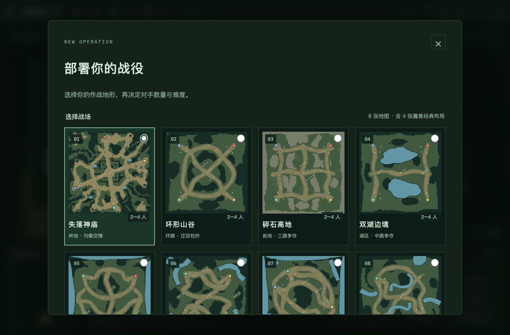

# FudanCraft · 远征纪元 2.3

**中文** | [English](README.en.md)

[在线试玩（GitHub Pages）](https://pj-fdu.github.io/fudan-craft-web/) · [Pages 部署说明](docs/GITHUB_PAGES.md)

基于 [PJ-FDU/fudancraft](https://github.com/PJ-FDU/fudancraft) 的 **Node.js + TypeScript + Three.js** RTS 重制版，提供 WebSocket 服务器版和 WebRTC P2P 静态版。游戏包含「采集 → 建造 → 研发 → 战斗」的完整经济链，支持单机战役、2–4 人自由对战和 1–2 位人类玩家合作对抗 AI。


## 四种族战役

在「新的战役」选择己方与 AI 种族，或在联机房间为自己的席位选族。工业联邦依靠电力和工厂模块，生群共生体通过孵化巢共享生产，星能议会依靠节点覆盖，远行者同盟使用可迁移装配站和固定补给塔。

选中核心支援单位后，技能面板会显示能量、冷却与可施法人数。桌面可以用 **U / Y** 选择当前技能组的前两个主动技能，触屏直接点技能，再点单位或地面。远行者选中装配站后可收拢、移动和架设。旧存档仍沿用存档原有的传统规则。

四种族新局按兵种权重计算人口：指挥中心提供 20 容量，每个完工的种族补给设施或单位增加 8，容量上限为 120。传统规则沿用 80 个移动单位的上限。下文的传统单位、建筑与科技表用于旧规则参考；四族完整阵容与前置条件以源码及游戏内科技链为准。

[四种族设计与对阵说明](docs/four-race-ability-design/four-race-ability-design.md)中的数值为设计基线。实际开局、生产和技能参数分别定义在 [种族规则](src/game/races.ts)、[单位与建筑参数](src/game/types.ts)和[技能表](src/game/abilities.ts)，费用、原生护盾和科技时长是供对战调试的初始值。

## 启动

需要 Node.js 22 或更高版本。

### 服务器版（WebSocket）

```bash
npm ci
npm run dev
```

打开 [http://localhost:4320](http://localhost:4320)。首页为独立远征主菜单。选择「新的战役」，先设置交锋人数、AI 难度与四种策略风格，再进入「选择战场」二级菜单，从八张地图中选图并确认部署。联机房间由房主在开局前选图；两位朋友合作需要四人地图。

依赖通过公共 npm registry 安装，以 `package-lock.json` 锁定版本。首页封面和界面字体随游戏本地加载。字体来源与许可证见 [界面字体](docs/FONTS.md)。

```bash
npm run build
npm start
```

生产模式在同一端口提供游戏页面和 `/ws`。开发与生产默认监听 `0.0.0.0:4320`，启动时会打印本机地址和局域网 IPv4 地址。可用 `PORT=8080 npm start` 更换端口，或用 `LISTEN_HOST` 指定监听地址。

通过互联网和朋友联机时，见 [公网部署](#公网部署)。局域网联机可直接使用启动时打印的地址。

### GitHub Pages 静态版（WebRTC P2P）

可直接打开[在线试玩](https://pj-fdu.github.io/fudan-craft-web/)。自行部署时，构建无需 Node 服务的静态版，通过 Metered 建立 WebRTC P2P 对战：

```bash
cp .env.pages.example .env.pages.local
# 填入 Metered Realtime 的 VITE_METERED_PUBLISHABLE_KEY（pk_live_ 公钥）
npm run build:pages
npm run preview:pages
```

输出为 `dist-pages/`，本地预览地址为 [http://localhost:4330](http://localhost:4330)。开发模式使用 `npm run dev:pages`。房主创建房间后复制完整邀请链接，朋友打开链接、填写代号并加入，再由房主选图开始。支持自由对战和合作对抗 AI；房主需保持页面打开，刷新或离开会结束房间。房间仍在运行时，其他玩家可在断线后 120 秒内恢复席位。配置、发布工作流和运行边界见 [GitHub Pages P2P 接入](docs/GITHUB_PAGES.md)。

### 对局通讯

联机对局点右上方「聊天」，或按 Enter 打开文字面板；Shift+Enter 直接打开队友频道。支持公屏 / 队友文字、六种快捷消息、收起时的短暂消息预览及玩家屏蔽。手机小地图固定在左下，长按或右键发送进攻 / 危险 / 集合 / 支援标记。合作玩家可主动开启队友语音，切换按住说话（按钮 / V），独立调整队友静音和音量并查看说话提示；离房或断线停止采集。两种联机版本均支持，网络要求和 TURN 配置见 [战场通讯](docs/BATTLE_COMMUNICATIONS.md)。

### 验证与性能

发布前运行 `npm run check:release`，依次执行全量测试、服务器构建、Pages 构建，以及仓库子路径、公共素材和 WebRTC 模块检查。Pages 构建需先配置上述公钥。

设置提供自动 / 优先画质 / 省电模式。手机支持编队 1–3 保存、召回和连点定位，以及空闲工人定位与兵种筛选。战局菜单与战后界面可查看经济 / 战斗统计并导出 JSON。源码锚点和验收记录见 [七项改进验收](docs/IMPROVEMENTS.md)；`npm run benchmark` 可复现 [平衡基准](docs/benchmarks/balance.md)。

## 八张战场

八张地图的新局均为 512 × 512 格，每格 32 世界像素。战场面积是上一版 256 × 256 格的四倍，单位和建筑沿用原有的格数占地。失落神庙保留林间路网；环形山谷侧重外环包抄，碎石高地侧重三路隘口争夺，双湖边境侧重中央走廊和湖岸绕行。另有参照经典布局的回音岛 EI、扭曲草地 TM、海龟岩 TR、泰瑞纳斯看台 TS。林带由可逐棵采集的林团、空地和林道组成，每个出生区外围都有前哨金矿和油点。

选图界面提供真实地形预览。新开战役使用最新地形；存档记录地图与地形修订号，旧战局继续使用其原布局。缺少地图字段的旧 v2 存档识别为失落神庙。详见 [地图参数与验证记录](docs/FOUR_MAPS.md) 和 [自然化前后对比](docs/map-naturalization-comparison.png)。



## 3D 战场

战场使用 Three.js 和 WebGL 2，全部四族单位、建筑与自然物件由 Blender 导出的 GLB 加载。新增可编辑骨架工程、Cycles PBR 图集、真实分叉树木、立体地表与凹岸线波浪水面；构建、编辑和验证见 [Blender 工作流](docs/BLENDER_GAME.md)。战机有飞行高度，炮弹沿空中弧线飞行。地形阻挡、建筑占地和视野沿用现有地图与战斗规则，v2 存档可直接读取。

四族 78 个模型进一步新增高模曲面与局部雕刻、独立 UV、高低模法线和 AO 投射，以及各模型专属的颜色与 ORM 纹理。装甲、甲壳、角质和帆布采用不同造型与材质规则，见 [模型精修与重建](docs/BLENDER_SCULPT.md)。

工业联邦工程采集车已单独重做斜面驾驶舱、四轮胎纹和轮毂、双液压臂、伸缩导轨与采集钳，使用独立 2K PBR 和可编辑 Blender 工程。材质结合生图纹理与按部件位置控制的掉漆、锈流和积泥，并加入挡泥板及采集臂的实体凹陷。查看 [做旧前后](artifacts/worker-hero/battlewear-comparison.png)、[参考对照](artifacts/worker-hero/reference-comparison.png)、[实际图鉴](artifacts/worker-hero/game-worker-idle.png) 和 [专项重建说明](docs/WORKER_HERO.md)；使用 `npm run assets:worker` 只重建这辆车。

幽影狙击手也使用独立高低模和 2K PBR，胸腰采用弧形收边，双手握持与贴腮瞄准按枪械接触点求解，披风用八段骨骼独立风摆。精密步枪包含枪机、真实孔洞、分段瞄准镜和可调枪托。查看 [修订前后对照](artifacts/sniper-hero/revision-comparison.png)、[握枪侧面](artifacts/sniper-hero/grip-side-detail.png)、[披风动作](artifacts/sniper-hero/cape-motion.gif)、[光追瞄准](artifacts/sniper-hero/cinematic-aim.png) 和 [重建说明](docs/SNIPER_HERO.md)；使用 `npm run assets:sniper` 单独重建。

模型使用真实圆角装甲、平滑曲面和分层机械结构。车辆包含履带块、轮毂螺栓、散热百叶和检修盖；建筑包含扶梯、管道法兰、护栏与屋顶设备。沿用原创图集表现磨损，同时按表面区分金属、喷漆、橡胶、织物和玻璃的粗糙度与金属度，并加入轻微凹凸。

战场光照采用 ACES、烘焙天空反射、冷暖补光与方向光阴影，新增读取实际贴图法线、albedo、粗糙度和金属度的屏幕空间反弹及动态反射，源表面与接收面均遵守战争迷雾。「间接光照」提供基础／均衡／精细三档，自动性能模式可临时降低效果上限并保留偏好。模型图鉴另有可选「电影光追」：运动时显示没有路径采样噪点的光栅预览，暂停动作与镜头后由 WebGPU 对完整模型的三角形 BVH 计算六次反弹和面积光软阴影，完成全分辨率 256 次采样及静态降噪后才显示光追结果。准备期间保留实时画面并显示进度；恢复运动立即切回光栅，两种模式的光照会有所不同。查看 [动态与静态效果](artifacts/cinematic-hybrid/comparison.png)、[实际光追对照](artifacts/worker-hero/cinematic-comparison.png)、[当前战场](artifacts/worker-hero/cinematic-battle-high.png)、[实现与预算](docs/3D_RENDERING.md)。

传统九类移动单位使用骨骼蒙皮和部件贴图。步兵与机甲有膝、踝和肩肘关节，步态随实际移动距离推进。车辆会转动车轮、控制炮塔和机械臂，战机转向时侧倾。战场对局最多绘制 60 帧每秒，暂停时最多 24 帧；首页不绘制或模拟战场，动态阴影最多每秒更新 30 次。

四族单位与建筑共用表面做旧：金属锈蚀、掉漆、油污和弹痕，陶瓷与甲壳擦伤，布料和橡胶积灰；阵营色板也保留使用痕迹。磨损随部件运动，沿用现有合批与纹理。[四族实机效果](docs/faction-materials/weathering-preview.jpg)。

默认镜头俯角约 38°。按 Z / C 或点击缩放栏的旋转按钮，可每次旋转视角 30°。滚轮继续围绕指针缩放，框选以屏幕上的单位位置为准，小地图边框随视角旋转。头像、动画图鉴、HUD 和小地图保留二维信息展示。WebGL 2 不可用时显示启动错误；图形上下文中断时等待浏览器恢复。

## 远征主菜单

首页使用原创神庙、机甲与坦克场景。宽度不超过 900 CSS 像素时使用约 37 KB 的 WebP 封面，并停用镜头缓动和漂浮粒子。语言、声音和全屏控件随首页就绪。打开战役、联机或档案时才加载游戏脚本，有本地存档或联机席位时会在首屏之后读取状态。战场图集与 3D 场景在进入战场时加载。 [移动端首屏实测](docs/IMPROVEMENTS.md#移动端首屏)

「继续远征」使用与正式读档相同的校验，只有有效本地存档才可进入，并显示地图与作战时间。单机战局菜单的「保存并返回主菜单」保存当前进度；联机菜单的「离开战役并返回主菜单」退出房间，仍由服务器接管战局。档案、设置、指南、音效和全屏均可直接从首页使用。↑ / ↓ 选择菜单，Enter 确认；首页不会响应生产、暂停或控制台快捷键。

提供 [桌面效果](docs/title-screen-wide.jpg)、[手机效果](docs/title-screen-mobile.jpg) 与 [横屏效果](docs/title-screen-landscape.jpg)。

战役设置和选图沿用同一电影感背景。第一层选择人数与难度；第二层提供八张地图列表、完整地形预览、资源 / 出生位置图例与部署摘要。返回上一级保留所有候选配置。先选择三人 / 四人战役时，EI、TS 标为「限 2 人」并禁用；旧选择若不支持当前人数，自动改为兼容地图并说明原因。Esc 返回上一级，Enter 进入下一步或部署。从战局打开设置后取消，会恢复原来的暂停或运行状态。

两级菜单由 `src/game/operation-menu.ts` 管理候选配置，`src/main.ts` 负责实际开局；样式见 `src/operation-menu.css`。大地图与联机缩略图共享 `src/game/map-picker.ts` 的真实地形绘制。提供 [战役设置效果](docs/operation-settings-desktop.jpg)、[地图二级菜单](docs/operation-maps-desktop.jpg) 和 [手机选图效果](docs/operation-maps-mobile.jpg)。

## 声音与通讯

加入原创远征主题、探索 / 交火动态配乐、风声 / 湖水，以及各兵种的开火、弹着、爆炸、治疗和界面音效。九类建筑各有选中音和专属环境声，工厂敲击、木材厂锯切、机库引擎等随距离与实际生产 / 施工状态变化。九类移动单位和指挥播报使用 Qwen3-TTS 中英文配音。选中和移动回应各有两条轮换，共享 5 秒间隔；采集和维修有工程车专属台词。素材包含 176 个 MP3。

首次点击或按键后开启播放。右上角「声音」一键静音；首页「游戏设置」和战场「战局控制」提供五路音量、通讯字幕和语音试听，偏好随浏览器保存。语音自动降低音乐音量，后台标签页暂停音频。战斗声沿用权威可见事件与距离衰减，暂停、读档和返回菜单不会补播旧战斗声。

主菜单「EN / 中文」与设置中的「语言与语音」同步切换全游戏界面和录音，偏好自动保存，当前战局继续保留。菜单、地图说明、单位 / 建筑 / 资源详情、提示、动画图鉴和字幕均支持两种模式。实现与覆盖规则见 [中英文说明](docs/LOCALIZATION.md)。

素材清单及两种语言的台词以 `src/game/audio-catalog.ts` 为准。可用 `npm run audio:generate` 重建配乐和音效，用 Qwen3-TTS 脚本重建中英文配音。玩家端直接播放随站点发布的 MP3。详见 [声音文档](docs/audio.md)。

## 当前控制台布局

桌面上方为金属工具栏，包含库存、电力供给 / 消耗、战局时间、暂停、面板、全屏、菜单和指南。移动端使用独立布局：48px 顶栏只保留库存、暂停和菜单；底部为小地图、可展开的选中摘要与五个透明底快捷指令，生产 / 建造 / 科技按需展开。宽度不超过 800px 或主指针为触屏时启用，横竖屏和安全区均独立适配。共享的小地图、生产按钮和详细读数在两种布局之间移动，不重复模拟或维护状态。

底部参考 Warcraft III / StarCraft 的仪表台分区与材质：深色金属机壳、铜色包边、凹槽按钮和青色状态灯。左侧嵌入小地图，中间显示大型单位识别图与状态，右侧为作战指令和图标九宫格。面板贴底，两侧高、中间低；桌面高度按视口约 30% 缩放，范围 188–246px，1280×720 下两侧约 216px、中间 198px。

多选时显示编队缩略图：点击单选，Shift 点击移出当前选择；「定位」将镜头移向选中单位。单选显示生命、攻击、射程、移速或载货；多选显示编队构成和合计生命。生命条分段显示，低于 30% 时变为红褐色。选择施工建筑或其工程车时显示实际施工百分比、施工/就位/等待续建状态；选择生产建筑显示该建筑当前生产或研究的进度和剩余时间，缺电时标明暂停。中央底部保留人口、采集车数量和可点击取消的全局队列。

建筑和资源圈与单位圈共用贴地细描边，模型会遮住后侧圆弧，攻击范围也放在地面层。资源可点击选中，中央显示剩余量；已选工程车时，点击资源仍下达采集指令。Esc 清空资源选择。

右侧生产、建造、科技使用相同的三列图标格；训练、资源建筑和作战指令按钮标明快捷键。未解锁图标灰显并标识前置条件；悬停或键盘聚焦显示说明、费用、耗时和不可用原因，B 展开后直接显示详情。选中建筑时禁用移动部队指令；受损建筑可直接点击「维修」指派附近工人。桌面样式在 `src/battle-hud.css`，触屏布局与行为在 `src/touch-hud.css` 和 `src/game/touch-hud.ts`。

触屏双击单位选择当前视野同类，三击选择己方全部移动单位（含工人）；长按 420ms 后拖动框选，直接单指拖图，双指平移和缩放战场。选中工人点击资源、受损建筑或未完工建筑，可直接采集、维修或续建。网页阻止快捷键、Ctrl / Cmd 滚轮、双击和捏合引发的页面缩放，保留游戏相机缩放；浏览器菜单或系统强制缩放不受网页控制。

工人维修、共享数值和新 AI 规则详见 [玩法参数与验证](docs/GAMEPLAY_RULES.md)。AI 会保护采集线、维修、补建、侦察、留守、撤回残血单位并根据可见敌军选择兵种；难度只改变策略，不增加资源或伤害。

## 2.3 移动与战斗同步

- 地面单位按圆形碰撞体进行扫掠检测、局部避让与拥堵重寻路；编队终点间距增至 64，采集、交付和施工使用独立作业位与等待位。空闲友军能侧让，旧存档中的重叠和建筑内单位会尝试恢复到可通行位置。
- 路线规划会避开拥挤位置，狭窄通道里的友军会排队或后退让行。编队使用错开的落点，目标被占用时会尝试在附近的可达空地停靠。
- 步枪等即时命中武器先播放攻击前摇，再同步出现射线与伤害；坦克、火炮的炮弹飞到落点后才结算范围伤害。炮弹发出后独立存在，发射者阵亡不会撤销炮弹。移动或停止指令可以打断尚未发射的攻击。
- 步态由实际位移驱动，停止时收步；步兵、采集车、坦克加入轻微起停与后坐变化，车辆出发和瞄准平滑转向。动画图鉴同步使用实际动作节奏。本轮沿用已有图集，未新增美术关键帧。
- 敌方最大生命值由权威模拟直接提供，修复装甲升级后的血条比例；敌方科技及炮弹伤害载荷仍由服务端过滤。
- 保持 v2 存档兼容，保存待发攻击和飞行中的炮弹。详见 [移动与战斗实现说明](docs/MOTION_COMBAT.md)。

## 2.2 动态战场

使用内置 imagegen 新生成 16 张素材，素材共包含 **876 个动画 / 阶段画格**，实际提示词与图集说明见 [动画素材文档](docs/ANIMATION_ART.md)。

- 9 类移动单位保留八方向；每方向包含 2 帧待机、4 帧移动、2 帧攻击 / 治疗 / 工程作业、2 帧阵亡，共 720 格。采集与施工共用采集臂作业帧，按真实工作状态播放。
- 松树、橡树、白桦、灌木采用固定树形的连续微风变形，约 12 秒一轮；只让树冠轻摆，树根与下部树干固定。资源树林使用同一套风动。
- 9 类建筑各有 4 个施工阶段、4 级损毁外观、4 帧生产循环。生产随真实队列和电力状态播放，施工配合焊接烟尘，重损建筑播放火焰烟雾，出兵和研究完成有部署光效。
- 新草地、泥土使用独立 1254×1254 纹理；按视口、缩放和屏幕像素比生成地表分块，最高 4 像素 / 世界像素，缓存上限 64 MiB。放大时不会再采样一张固定 4096×4096 的整图。
- 阵亡单位立即退出逻辑，视觉上保留短暂倒地 / 残骸和渐隐；联机动画事件按发生时和当前视野过滤，不泄露迷雾中的敌人。

进入 **战局菜单 → 动画图鉴** 可查看全部兵种与八方向、逐帧切换、查看建筑阶段、树木和地表。菜单可关闭部队与环境动画。继续兼容 2.0 / 2.1 的 v2 存档，读取时补齐新增动画数据。

## 2.1 视野与操作优化

2.1 引入 44 像素顶部薄栏和半透明浮动控制台，画布填满视口；当前底部已改为上方说明的经典 RTS 布局。调度面板按需展开，任务目标默认收起；V 隐藏控制台，B 展开 / 收起调度。页面不再被大段信息栏和最小页面高度挤出屏幕。

点击右上角全屏按钮或按 F 调用浏览器 Fullscreen API。受浏览器权限或内嵌预览限制时自动进入沉浸布局，并明确提示；退出按钮 / F 可恢复。原生全屏也可按 Esc 退出。

- 中键、右键拖动，或按住空格 + 左键拖动：抓取并平移地图。右键轻点仍然下达指令；拖动超过阈值后不会误发移动指令。
- 滚轮：以鼠标下的世界位置为锚点，平滑缩放。Shift + 滚轮横移，Alt + 滚轮平移。菜单可开启触控板模式，双指滚动改为平移、捏合仍缩放。
- 触屏：单指拖图、双指同时平移与缩放。手指抬起不会误发指令。
- 轻按空格回基地；按住空格拖图后松开不会跳回基地。
- 地图边界与窗口 / 全屏尺寸变化由统一相机处理，单位位置使用渲染插值。

九类移动单位各有八个独立视角，共 72 帧。根据移动、采集、建造和攻击朝向选择；最短转角与切换滞回减少方向闪动。详见 [八方向素材与实际提示词](docs/DIRECTIONAL_ART.md)。2.1 继续使用 v2 存档，兼容 2.0 存档。

## 资源与采集

三种资源独立计算，**没有被动收入**：

| 资源 | 作用 | 采集条件 |
| --- | --- | --- |
| 金矿 | 训练单位、建设与研发 | 工程采集车 |
| 木材 | 建筑、兵种和科技的材料 | 工程采集车；木材加工厂提升效率 |
| 石油 | 装甲部队、航空与先进科技 | 附近完工的石油精炼厂 + 建在油点上的油井 |

新局初始金矿 1,500 / 木材 600 / 石油 0。传统规则开局拥有指挥中心、电站、步兵营、3 辆工程采集车、2 名步兵和 1 辆侦察车；四种族开局使用各自的生产建筑、配套设施与初始兵种，见 [种族阵容](src/game/races.ts)和[开局实现](src/game/engine.ts)。采集车会自动开始采集附近金矿与木材；战车工厂需要 80 石油。旧存档继续使用原有采油方式和地图修订。

选中采集车，右键金矿或树木即可指派工作。每辆车基础采集速度为 20/秒，货仓容量 100。满载后优先前往预计行驶时间最短的可达交付点。指挥中心和木材加工厂接收金矿与木材，精炼厂也接收金矿。**货物交付后才计入库存**。选中金矿可查看作业和排队车辆。最后一批金矿交付后，采集车会寻找距原矿 1,200 世界像素内已探索、可达的金矿。没有合适目标时，采集车在交付点等待指派。

先在油点附近建造精炼厂。放置预览会标出 14 格的管道覆盖范围和可连接的油点。完工后，在覆盖范围内的油点上建造油井。油井花费 120 金、50 木，施工 6 秒，完工后以每秒 14 石油的速度，经可见管道输送到最近的合格己方精炼厂。精炼厂被摧毁时，油井会改接范围内的其他完工精炼厂，暂时没有可连接目标时停产。

每方主矿 10,000 金矿、主油点 2,600 石油，近基地树林有 24 棵树、合计 7,200 木材。地图上的松树、橡树和桦树都可采集，每棵 300 木材。砍完会留下树桩并开放其占地，工人会从可达林缘逐层采伐，余货继续装满再运输。水、岩石和地图边界不会随砍伐消失。前哨有 4,500 金矿和 1,500 石油，远端扩张点分别有 6,000 金矿和 1,800 石油，中心争夺金矿为 9,000。采集车可被攻击，保护补给线有直接的经济价值。

双湖边境和环形山谷启用前哨试点。小地图用菱形标出已探索的前哨金矿和油点，并显示己方在产油井的预计枯竭时间。战场上的补给提示可点击定位，战后统计列出关键事件。试点的 AI 会先侦察前哨、护送施工，并优先攻击发现的前线补给设施。对照结果与复现命令见 [前哨试点](docs/GAMEPLAY_RULES.md#前哨试点)。

各图总库存、分布约束、存档兼容与公平性回归见 [资源规则](docs/RESOURCE_ECONOMY.md)。

## 建筑与发展路线

在右下角「基地建设」选择建筑，然后点击当前视野内的空地。系统优先使用已选中的采集车，否则分配其他采集车。按 T 或点击「旋转建筑」可旋转 90°，占地预览与阻挡格同步旋转。绿色预览可放置，红色表示地形、视野或间距不合适，Esc / 右键可取消放置。

建造需要工程采集车抵达并工作，不会瞬间完成。施工被打断后，选择采集车并右键未完成建筑可继续。

以下为传统规则的建筑路线。四种族有各自的生产建筑、补给方式和解锁条件，请在游戏内查看当前种族的科技链。

| 建筑 | 功能与前置 |
| --- | --- |
| 指挥中心 | 生产采集车、接收资源；被摧毁即出局 |
| 聚能电站 | 提供 60 电力；需要指挥中心 |
| 步兵营 | 步兵、医疗兵、狙击手；需要电站 |
| 木材加工厂 | 伐木效率 +50%，接收木材和金矿 |
| 石油精炼厂 | 处理 14 格内油井的石油，接收金矿，需要步兵营 |
| 油井 | 建在有储量的油点上，经管道自动输油，需要附近完工的己方精炼厂 |
| 战车工厂 | 侦察车、坦克、火炮、机甲；需要步兵营 |
| 科技研究中心 | 五项科技与医疗兵；需要步兵营 |
| 航空机库 | 战机生产；需要战车工厂 |
| 哨戒炮塔 | 自动防御地面与空中目标；需要步兵营 |

建筑有独立生产队列，同一建筑顺序生产，不同建筑并行工作。传统规则及工业联邦电力不足时，军事生产与研究暂停，指挥中心仍可训练采集车。排队任务可点击取消并全额退款；生产建筑被摧毁时，它尚未完成的任务自动退款。每方最多 35 座建筑；传统规则最多 80 个移动单位，四种族使用前述人口容量与兵种权重。

## 科技树

以下为传统规则的五项科技，在研究中心按队列研究，花费三种资源并需要时间。四种族另有阶段升级、专属研究建筑和科技，实际可研究项目以当前种族的科技链为准。

| 科技 | 实际效果 | 前置 |
| --- | --- | --- |
| 精密武器 | 全军伤害 +20%，解锁狙击手 | 研究中心 |
| 复合装甲 | 作战单位当前和最大生命值 +25% | 研究中心 |
| 智能物流 | 采集效率 +50%，货仓 100 → 150 | 研究中心 |
| 先进工程 | 解锁火炮、泰坦机甲 | 精密武器 + 战车工厂 |
| 航空技术 | 解锁战机 | 精密武器 + 航空机库 |

右下角「科技研发 → 查看完整科技链」可查看游戏内发展路线。完成的科技会影响现有和后续生产的单位。

## 九类单位

以下为传统规则的九类单位。四种族包含额外的作战和支援兵种，完整阵容见 [种族规则](src/game/races.ts)，技能见 [技能表](src/game/abilities.ts)。

| 单位 | 定位 | 生产 / 解锁 |
| --- | --- | --- |
| 工程采集车 | 采集、交付、建造 | 指挥中心 |
| 突击步兵 | 基础射击与护卫 | 步兵营 |
| 侦察战车 | 快速移动、广视野 | 战车工厂 |
| 战地医疗兵 | 自动治疗附近受伤友军地面部队 | 步兵营 + 研究中心 |
| 幽影狙击手 | 远程精确射击，对步兵额外伤害 | 步兵营 + 精密武器 |
| 攻城坦克 | 重装甲、范围伤害 | 战车工厂 |
| 远程火炮 | 超远程大范围轰击，无法对空 | 战车工厂 + 先进工程 |
| 猎隼战机 | 无视地形的空中火力 | 航空机库 + 航空技术 |
| 泰坦机甲 | 高生命值的重型突击 | 战车工厂 + 先进工程 |

精确费用、生命值、射程、伤害、时间、电力等集中在 `src/game/types.ts`，可直接调整平衡。击杀返还被摧毁目标金矿费用的 20%。

## 新美术与地形

新增四张生成图集，运行时从本地加载，不依赖在线生图服务：

- `public/assets/generated/units-v2.png`：9 类手绘单位。
- `public/assets/generated/buildings-v2.png`：9 类手绘建筑。
- `public/assets/generated/nature-v2.png`：16 类环境 / 资源物件，包括松树、橡树、白桦、灌木、岩石、遗迹、水塘、金矿、树林、油田、花草、树桩和蕨类。
- `public/assets/generated/terrain-v2.png`：草地、泥土、岩石与沙地材质。

统一 2.5D 手绘风格、俯视正交相机、象牙白装甲 / 石墨金属 / 青绿灯光。新战场沿原有地形和路网向外展开，水塘、石块与树林的逻辑阻挡进入寻路，资源点耗尽后显示残留物。单位采用八方向多状态序列帧；建筑施工、生产与损毁、林木风动和战场特效均使用新图集。转向和位置继续做平滑插值；不同阵营共用图集，通过队伍标记和生命条区分。

生成方式、文件布局与**实际提示词**见 [docs/GENERATED_ART.md](docs/GENERATED_ART.md)。

## 操作

| 操作 | 键位 |
| --- | --- |
| 点选 / 框选 / 多选 | 左键 / 拖动 / Shift + 左键 |
| 移动 / 攻击 / 采集 / 续建 | 选中单位后右键相应目标 |
| 攻击移动 | A，再点目标地点 |
| 驻守 / 停止 | H / X |
| 前两个主动技能 | U / Y，选择技能后点击目标 |
| 维修己方建筑 | 选中工人后右键受损建筑，或 J 后点击建筑 |
| 训练步兵 / 采集车 / 坦克 | Q / E / R，仍需满足前置 |
| 全选作战部队（不含采集车） | F2 |
| 轮选空闲采集车，无空闲时选择一辆采集车 | F3 |
| 保存或覆盖编队 | Ctrl 或 Cmd + 数字键（1–9、0） |
| 把当前选中单位追加到编队 | Ctrl 或 Cmd + Shift + 数字键 |
| 召回编队 / 镜头定位 | 数字键 / 快速连按同一数字键两次 |
| 把编队加到当前选择 | Shift + 数字键 |
| 放置石油精炼厂 / 油井 / 木材加工厂 | I / O / L，仍需满足建造条件 |
| 设置新兵集结点 | G，再点战场 |
| 移动视野 | 方向键 / 中键拖动 / 小地图 |
| 回到基地 / 抓取平移 | 轻按空格 / 按住空格 + 左键拖动 |
| 平移地图 | 中键 / 右键拖动、方向键、小地图 |
| 缩放 | 滚轮围绕鼠标缩放，+ / − 围绕视野中心缩放 |
| 旋转 3D 视角 | Z / C，或缩放栏的旋转按钮 |
| 旋转建筑 | 放置预览时按 T 或点击「旋转建筑」 |
| 全屏 / 隐藏控制台 / 展开调度 | F / V / B |
| 暂停 / 恢复 | P（单机） |
| 取消指令 / 取消选择 | Esc |
| 操作指南 | ? |

桌面编队栏会显示每组当前存活的成员数。点击「保存」「追加」或「加选」，再点编号执行操作。直接点击编号召回，双击定位。单机编队随战局存档恢复。

移动端可直接下令、双击选择同类、三击全选或长按框选。网页保持固定比例，战场相机可单独缩放。

## 单机与联机

### 单机

支持手动存档、每 30 秒自动存档和切到后台时自动暂停。存档保存在当前浏览器，无法跨设备同步。v2 存档支持后续地图修订，旧版 v1 存档与 v2 经济系统不兼容。

AI 使用相同的采集、建造、生产与科技规则，不能凭空获取资源。休闲 / 标准 / 挑战难度的首次出击最早在 150 / 100 / 65 秒后，且需要集结足够兵力；遭到进攻时立即组织防守。

### 服务器联机与断线恢复

所有玩家打开同一个服务地址。房主选择对战模式和地图，创建房间后分享六位房间码，其他玩家加入后由房主开局。局域网玩家使用启动时打印的地址，例如 `http://192.168.1.20:4320`。自由对战支持 2–4 人，合作对抗 AI 支持 1–2 人。两人合作请选择四人地图。

服务端负责战局模拟、指令校验及每位玩家的迷雾和数据过滤。断线后由 AI 暂时接管，默认可在 120 秒内用原标签页自动重连或刷新恢复。主动离开会撤销席位。合作模式共享视野与胜负，各玩家独立管理资源和部队。战局结束后，房主可在同一房间发起再战。

服务会定期保存房间快照，正常关服时也会保存。重启后使用原快照目录恢复保留期内的房间和席位。

### Pages P2P 联机

所有玩家打开同一个 Pages 站点。房主建房后分享完整邀请链接，来宾加入后由房主选图开局。邀请包含 12 位房间编号和房主 `peerId`，仅输入短编号无法加入。

战局由房主浏览器的 Worker 模拟，其他玩家通过 WebRTC 连接房主。来宾断线时由 AI 接管，房间仍在运行时可在 120 秒内恢复；房主刷新或关闭页面会结束整个房间。P2P 不支持房主迁移、服务器持久化或联机本地存档。详见 [Pages 联机操作与生命周期](docs/GITHUB_PAGES.md#联机操作与生命周期)。

### 公网部署

用 HTTPS 反向代理接收公网流量，将页面、资源和 `/ws` 转发到同一个 Node.js 实例。HTTPS 页面会自动连接 WSS。房间由该实例维护，部署时应为它提供持久、可写的快照目录。

#### 启动服务

以下示例适用于 Nginx 和 Node.js 在同一台机器的部署。替换域名和快照目录，确认运行账号可以写入该目录。环境变量需要由启动命令或进程管理器注入。

```bash
npm ci
npm run build
LISTEN_HOST=127.0.0.1 WS_ALLOWED_ORIGINS=https://play.example.com \
  WS_TRUSTED_PROXIES=127.0.0.1 ROOM_STORE_DIR=/var/lib/fudancraft/rooms \
  npm start
```

#### 配置 Nginx

在对应域名的 HTTPS `server` 块中加入以下转发规则。WebSocket 升级头需要显式转发。示例将 `X-Real-IP` 覆盖为 Nginx 看到的客户端地址，75 秒读超时为服务端每 30 秒的心跳留出余量。 [Nginx WebSocket 代理文档](https://nginx.org/en/docs/http/websocket.html)

```nginx
location / {
    proxy_pass http://127.0.0.1:4320;
    proxy_set_header Host $http_host;
}

location = /ws {
    proxy_pass http://127.0.0.1:4320;
    proxy_http_version 1.1;
    proxy_set_header Host $http_host;
    proxy_set_header Upgrade $http_upgrade;
    proxy_set_header Connection "upgrade";
    proxy_set_header X-Real-IP $remote_addr;
    proxy_read_timeout 75s;
}
```

如果 Nginx 和应用在不同容器或主机，`WS_TRUSTED_PROXIES` 应填写 Node.js 实际看到的直接代理 IP，并通过内网或防火墙限制应用端口的访问。浏览器允许来源使用完整 Origin，包含协议和非默认端口，省略路径及末尾斜杠。信任地址留空时，按直接 TCP 对端计入限流。

#### 配置参考

| 环境变量 | 默认值 | 用途 |
| --- | --- | --- |
| `LISTEN_HOST` | `0.0.0.0` | 监听地址，同机反代可设为 `127.0.0.1` |
| `PORT` | 4320 | HTTP 与 WebSocket 共用端口 |
| `ROOM_STORE_DIR` | `.rooms/` | 房间快照目录，重启时复用 |
| `ROOM_RECONNECT_MS` | 120000 | 原席位的断线保留时间，单位为毫秒 |
| `WS_ALLOWED_ORIGINS` | 请求 Host 对应的 HTTP / HTTPS 来源 | 公网可设精确的 HTTPS Origin，多个以逗号分隔 |
| `WS_TRUSTED_PROXIES` | 空 | 允许提供真实客户端地址的直接代理 IP，多个以逗号分隔 |
| `WS_MAX_CONNECTIONS` | 512 | 单实例并发 WebSocket 上限 |
| `WS_MAX_PER_IP` | 24 | 每个客户端 IP 的并发上限，校园网或共享 NAT 按需调整 |
| `WS_ROOM_CREATES_PER_MINUTE` | 12 | 每个客户端 IP 每分钟的建房上限 |
| `WS_UNSEATED_TIMEOUT_MS` | 60000 | 未加入房间或离开以后，空连接的回收时间，单位为毫秒 |

#### 上线验证

1. 打开公开地址，并用 `curl -fsS https://play.example.com/api/health` 确认返回 `"ok":true`。
2. 用两个独立浏览器会话建房、加入并开局。在开发者工具的 Network → WS 中确认 `wss://play.example.com/ws` 的实际连接返回 HTTP `101`。
3. 在同一标签页刷新确认原席位恢复。然后正常重启应用，并在保留期内确认战局和席位仍可恢复。

| 遇到的问题 | 优先检查 |
| --- | --- |
| 首页可打开，WebSocket 返回 `403` | `WS_ALLOWED_ORIGINS` 是否与浏览器发送的 Origin 完全一致 |
| 握手返回 `429` 或 `503` | `429` 表示触及单 IP 的连接上限，`503` 表示实例达到连接上限或正在关闭。多人从同一出口访问时，检查代理 IP 配置以及 `X-Real-IP` |
| 返回 `400`、`502` 或未出现 `101` | 检查 `/ws` 的转发目标、升级头和 Node.js 监听地址 |
| 重启后无法恢复席位 | 确认复用了可写的快照目录，且原标签页仍在重连保留期内 |

静态缓存、快照传输和验证范围见 [公网联机工程记录](docs/IMPROVEMENTS.md#公网联机工程记录)。

## 实现与验证

```text
src/game/types.ts       单位、建筑、经济与科技配置
src/game/races.ts       四族阵容、前置条件、人口与覆盖
src/game/abilities.ts   主动与被动技能参数
src/game/balance.ts     维修、治疗与溅射的共享参数
src/game/ai.ts          经济分工、防守、侦察、反制与部队策略
src/game/world.ts       确定性自然物、障碍与资源点
src/game/resource-world.ts  有限矿藏、逐棵森林与砍伐后的地形
src/game/pathfinding.ts 二叉堆 A*，禁止斜向穿角
src/game/engine.ts      采集、建造、维修、生产、科技、战斗和存档
src/game/art.ts         生成图集和九类八方向行映射
src/game/camera.ts      相机、缩放锚点、方向量化与转向
src/game/controls.ts    鼠标 / 触屏手势与拖动防误触
src/game/touch-hud.ts   独立触屏布局与共享面板切换
src/game/viewport-lock.ts  页面缩放拦截
src/game/renderer.ts    3D 战场入口、信息标记和小地图
src/game/battle-scene.ts  Three.js 场景、立体特效、迷雾和鼠标拾取
src/game/models-3d.ts   单位、建筑与自然物的低多边形模型
src/home.ts            首页入口和游戏模块加载
src/shell.ts           首页控件、语言、音频与全屏
src/main.ts            输入、建造交互、科技树、存档和联机客户端
server/index.ts        HTTP、房间、命令校验、权威模拟
server/admission.ts    WebSocket 来源校验与可信代理地址
src/network/p2p-connection.ts  Metered 信令与 WebRTC 连接
src/network/host-room.ts  P2P 房间、席位与生命周期
src/network/host-worker.ts  房主浏览器中的权威模拟
```

逻辑 20 Hz，联机快照 10 Hz，视野 5 Hz。地表预绘到离屏 Canvas，索敌使用空间桶，迷雾按位压缩。编队分配不同目的格，移动加入扫掠圆形碰撞检测与局部避让。该方案不提供全局交通调度，极端双向拥堵仍可能需要调整指令。

```bash
npm test
npm run build
```

GitHub Actions 在推送和 Pull Request 时使用 Node.js 22 安装锁定依赖、运行回归测试并构建服务器与 Pages 产物。测试覆盖八张地图、四族规则与技能、采集与建造、AI、战斗与迷雾、动画和音频、存档兼容，以及真实 WebSocket 上的建房、断线接管、重启恢复与再战。P2P 测试覆盖固定房主邀请、席位恢复、指令归属及快照压缩与分片；详见 [Pages 验证说明](docs/GITHUB_PAGES.md#源码锚点与验证)。联机测试使用本机 3128 端口，需要允许本地监听。

Chrome 实际界面验证涵盖 3D 与 2D 维修、移动端多击 / 框选 / 捏合、生产下单、横屏布局、英文界面及桌面 / 触屏切换；参数和证据见 [玩法参数与验证](docs/GAMEPLAY_RULES.md)。

## 许可

本项目采用 [Apache-2.0](LICENSE)。上游地图数据、生成素材和字体的来源及适用条款见 [来源与许可](THIRD_PARTY_NOTICES.md)。
