# 八张可玩地图

实现与验证日期：2026-11-19。源码为唯一事实来源；名称、人数和说明见 `src/game/maps.ts`，地形版本见 `src/game/world.ts`，资源数值与独立矿点锚点见 `src/game/resource-world.ts`，经典地图锚点见 `src/game/classic-world.ts`，自然地形生成见 `src/game/natural-world.ts`，曲线与湖岸几何见 `src/game/terrain-shapes.ts`。文件路径保留以兼容既有引用。

## 选择方式

- 单机：主页「新的战役」/ 战局菜单「新建战役」→ 设置人数与难度 →「选择战场」二级菜单 → 开始部署。返回设置保留当前选择。EI、TS 仅支持两人，三人 / 四人规模下禁用这两张地图；先前所选地图若不支持新人数，自动换成兼容地图。TM、TR 支持 2–4 人。
- 联机：房主在作战室选择地图，所有玩家同步看到选择；开局后地图锁定。两人地图最多接纳两人，已有三人或四人的房间不能切换为两人地图。
- 存档：v2 存档带 `mapId` 与 `mapRevision`；缺少地图 ID 时迁移到 `lost-temple`，缺少修订号时沿用修订 1。新局神庙与经典地图使用修订 5，山谷、高地、双湖使用修订 6。旧存档按原修订恢复地图尺寸、资源布局、剩余数量和 AI 开局节奏。未知地图、修订号或不匹配的玩家人数拒绝加载。

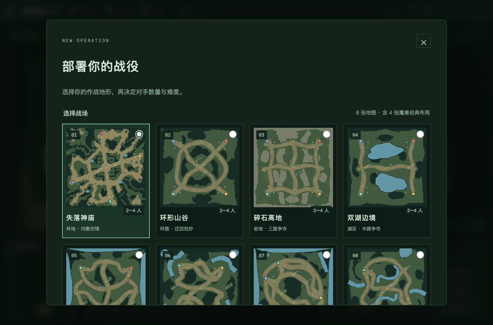

## 布局与物理参数

| 地图 | 稳定 ID | 可行走面积¹ | 布局 |
| --- | --- | ---: | --- |
| 失落神庙 | `lost-temple` | 68.10% | 保留原林间路网与中心争夺区 |
| 环形山谷 | `ring-valley` | 64.49% | 断续混合林带、四条弯曲入口、起伏外环 |
| 碎石高地 | `shattered-highlands` | 68.15% | 曲折岩脊、混合岩林、三条横向宽隘口 |
| 双湖边境 | `twin-lakes` | 62.07% | 不规则南北双湖、中央走廊、湖岸林丛 |
| 回音岛 · EI | `echo-isles` | 59.80% | 左右双基地、中央密林、南北岔路与外围海岸 |
| 扭曲草地 · TM | `twisted-meadows` | 48.51% | 四角基地、曲折林道、溪湾与多处扩张区 |
| 海龟岩 · TR | `turtle-rock` | 61.70% | 中央林区、环绕通路、两组近点与海岸凹湾 |
| 泰瑞纳斯看台 · TS | `terenas-stand` | 65.58% | 西北 / 东南双基地、两道弯河与中央交锋区 |

¹ 以新修订初始 `world.land` 中的空地格数除以总格数，含不可通行的地图边界和树木占地；不包含局内建筑及金矿、油井节点占地。砍树后可通行面积会增加。

- `[GRID]` 新局 512 × 512 格，每格 32 世界像素，世界尺寸 16384 × 16384。主矿、主油井和起始林位于基地附近，前哨矿点连接基地与远端扩张区。旧修订按各自的 128 × 128 或 256 × 256 格恢复。
- `[SPAWN]` 山谷、高地、双湖出生点依阵营顺序为 `(688,3408)`、`(3408,688)`、`(688,688)`、`(3408,3408)`；双人对角开局。所有自然地图出生区清障半径 480。
- `[ROUTES]` 手工锚点经 Catmull–Rom 曲线插值形成道路，所有道路中心线保护半宽 158；路面基准半宽 80，叠加低频变化及渐隐路肩。山谷环路以半径 1240 为基准，三阶、五阶起伏调整走向；高地保留三条横向路线。
- `[WATER]` 双湖中心 `(1910,1210)`、`(2200,2860)`，基础半径 `(860,390)`、`(825,425)`；轮廓分别旋转 −0.14 / +0.17 弧度。每湖 96 个轮廓点，经多频径向变化形成凹湾；岸线放大系数 1.045。碰撞、水面、小地图与预览共用轮廓。
- `[DRESSING]` 原林带内以坐标噪声生成不同疏密的林团、空地和连续的林道。林道为地面单位提供林间通行空间，树林可通过砍伐进一步打开。岩脊和水域保留永久阻挡，孤立空格填回阻挡，保证可通行区完整连通。
- `[ECONOMY]` 初始银行为金 1500 / 木 600 / 油 0。每个基地有 10000 金主矿、2600 油主井和 24 棵 × 300 木近基地林；所有真实松树、橡树、白桦均为独立木材节点。扩张金矿与油井分别布点，金矿 6000、油井 1800；有中心争夺矿的地图另加 9000 金。各图节点数量、库存、开采与兼容约束见 [资源规则](RESOURCE_ECONOMY.md)。

## 经典地图的布局锚点

| 地图 | 阵营 1 / 2 出生点 | 阵营 3 / 4 出生点 | 公共金矿 / 油井 |
| --- | --- | --- | --- |
| EI | `(752,1008)` / `(3344,1008)` | 无 | 3 / 2 |
| TM | `(1008,880)` / `(3088,3216)` | `(880,3088)` / `(3216,1008)` | 5 / 4 |
| TR | `(1264,752)` / `(2832,3344)` | `(624,1552)` / `(3472,2544)` | 4 / 2 |
| TS | `(864,1120)` / `(3232,2976)` | 无 | 3 / 2 |

- `[CLASSIC]` 这些是参照经典布局、适配当前 RTS 规则的地图，未导入原版 `.w3x`，不复刻野怪、商店、酒馆或英雄机制。用户提到的 IE 按 EI（Echo Isles / 回音岛）理解。TM 的外围岛屿作为阻挡装饰，所有可采集矿点都在地面单位可达的区域。
- `[RIVERS]` 以手工河道中心线生成两侧连续岸线；宽度随低频波形变化，并小于局部弯曲半径的 55%，避免内岸自交。端部由半圆收岸。凹河湾使用轮廓三角化，禁止用中心扇形跨越河湾内陆地。河岸不铺路，绕行通路由地形统一保护。
- `[REFERENCE]` 布局参照 Liquipedia 的 [EI](https://liquipedia.net/warcraft/Echo_Isles)、[TM](https://liquipedia.net/warcraft/Twisted_Meadows)、[TR](https://liquipedia.net/warcraft/Turtle_Rock)、[TS 预览](https://liquipedia.net/warcraft/Terenas_Stand/Preview)。本版本的地图由手工锚点、道路曲线和程序化地形组成，下面的截图来自本项目渲染器。

## 全景

以下截图记录资源重设计前的地形版本，由实际 Three.js 战场渲染器生成，仅在预览中揭开战争迷雾并缩小镜头。实际对局仍按阵营视野显示；最新矿点与树木规则以源码及资源文档为准。

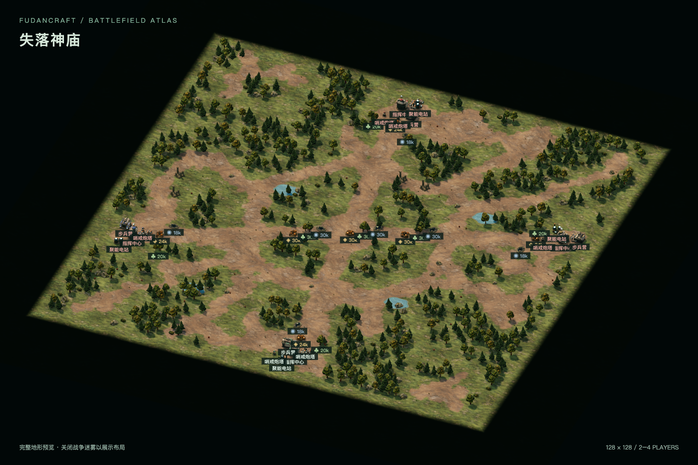
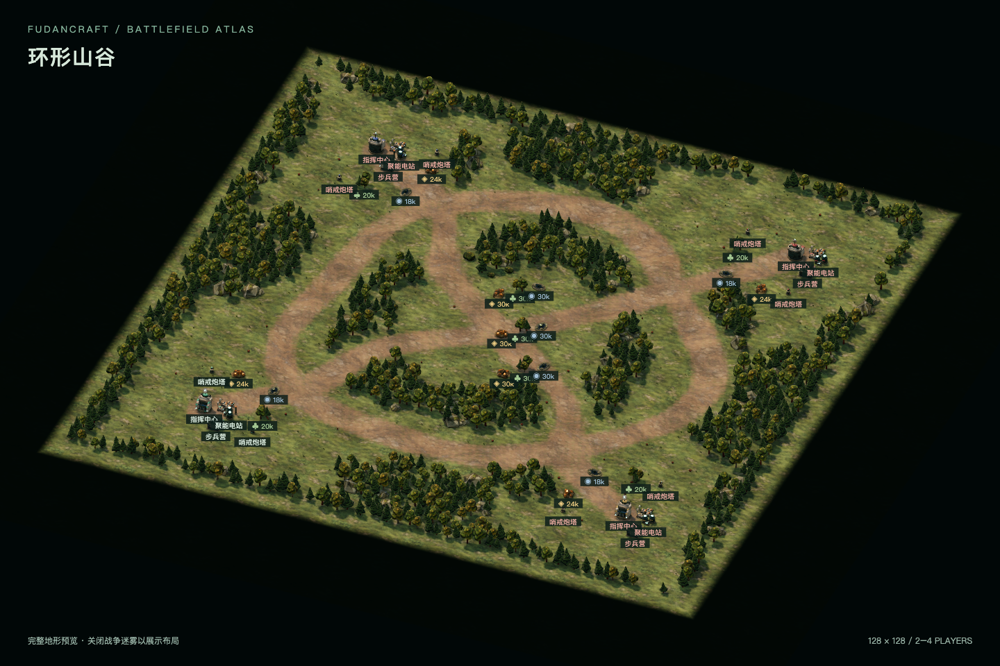
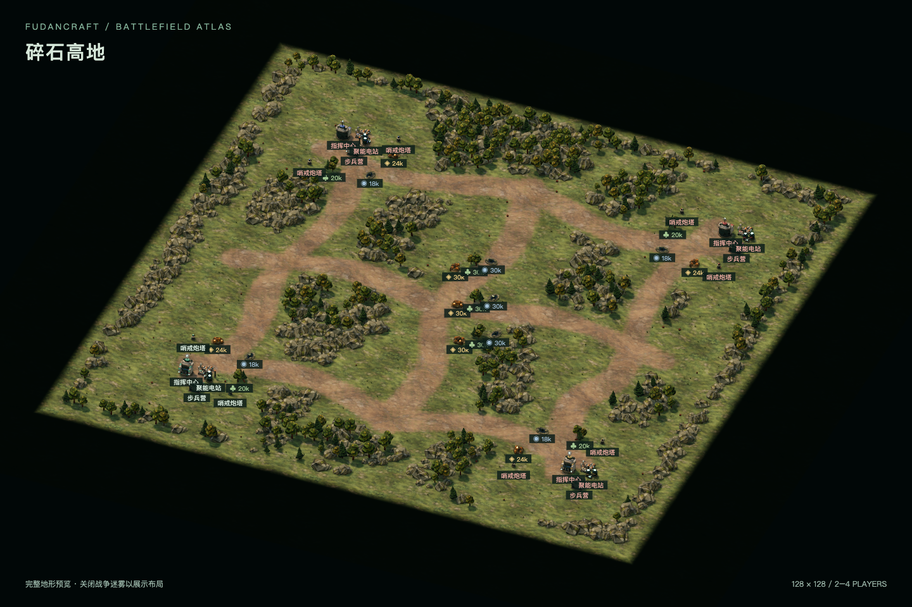
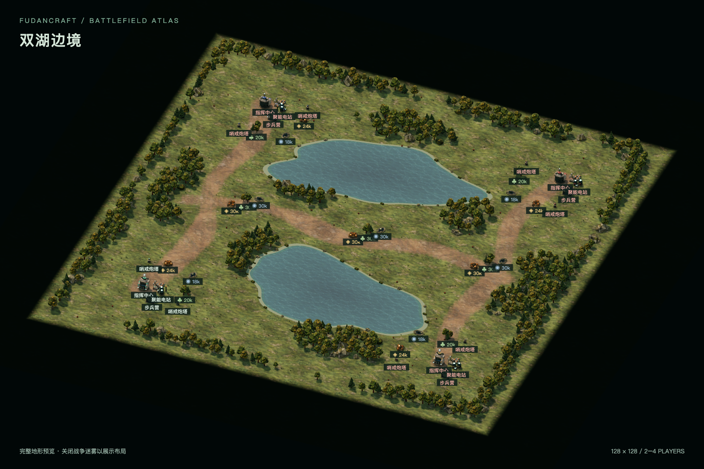

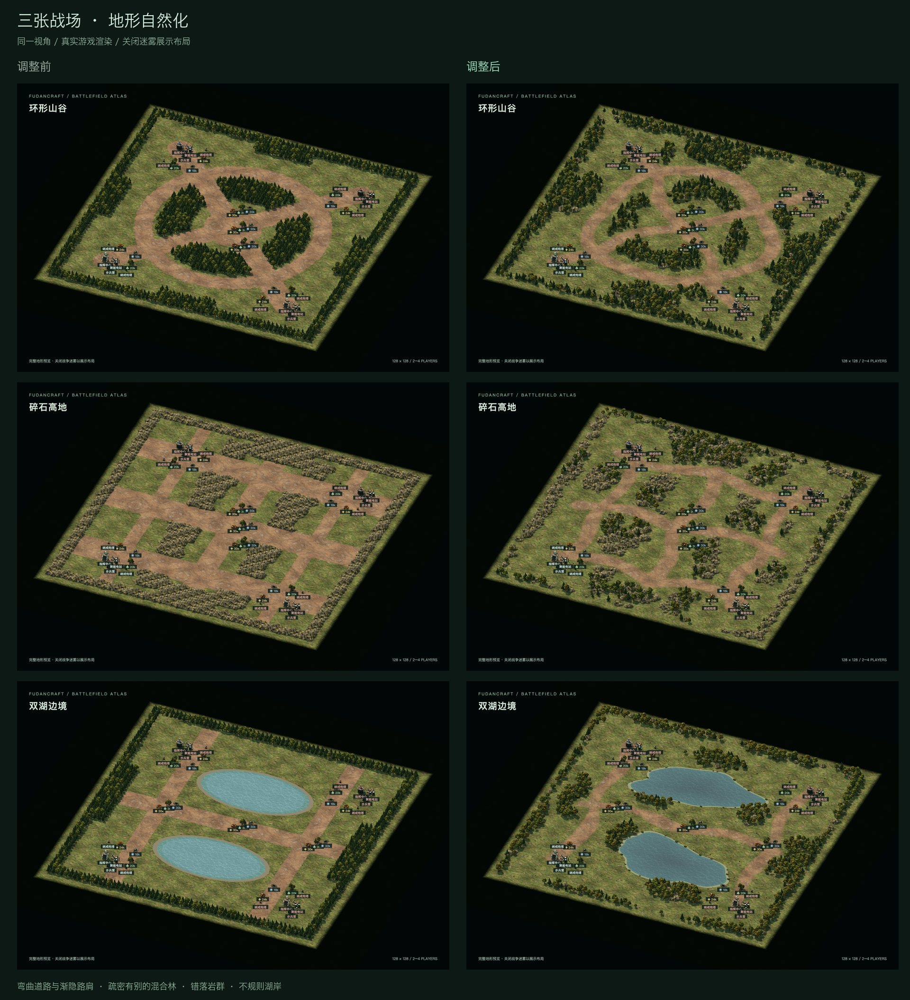

经典地图预览由实际游戏 Renderer 生成；为展示完整地形，预览揭开战争迷雾并显示所有阵营。

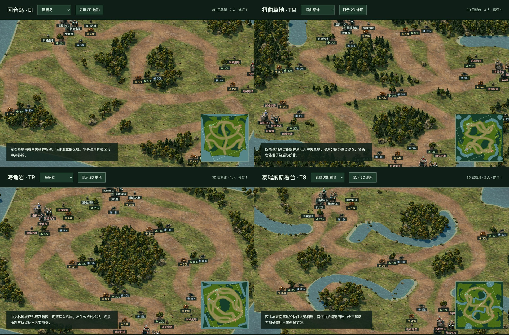

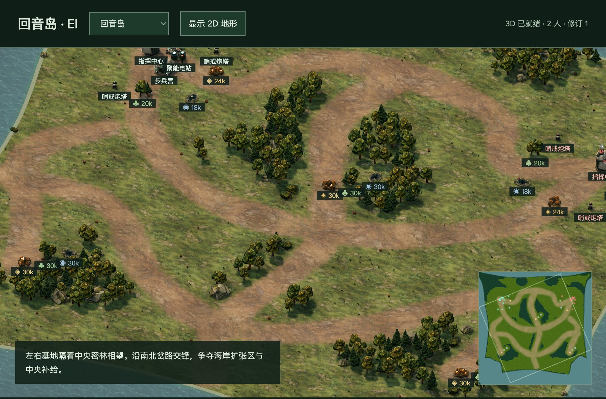
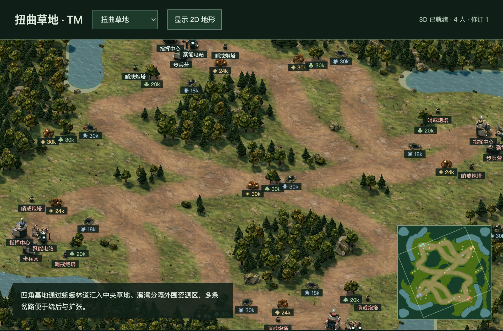
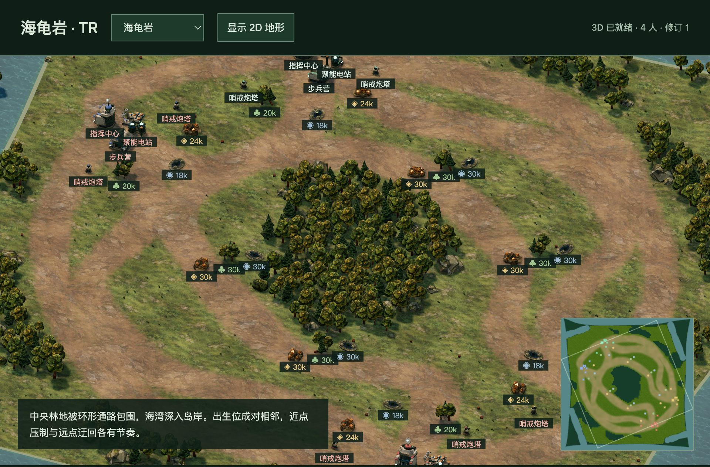
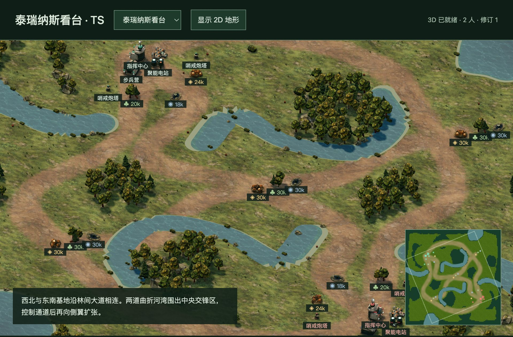

## 实现约束

- `[WORLD]` 每个 Engine 显式绑定 WorldData；按地图 ID + 修订号缓存并只读复用，局内阻挡数组独立复制。不能通过重写全局 LAND 切图。
- `[SSOT]` 寻路、建造验证、3D、2D、小地图与选图预览均读取对应地图的数据。历史默认导出保留为神庙，现有单图调用兼容。
- `[LIFECYCLE]` 切图替换地形缓存，释放旧地图几何、材质、路网纹理和阴影纹理；共用资产图集及地面几何继续复用。
- `[PROTOCOL]` 房间、`lobby`、`started`、`state` 均带地图 ID，`state` 同时携带地形修订号；`select-map` 仅允许未开局房主调用。地图白名单和人数上限由客户端与服务器共用。
- `[COMPAT]` 神庙修订 1 的地形、道路、装饰、资源点与四方开局单位 SHA-256 固化于 `tests/maps.test.ts`，旧修订保持一致。新局显式使用新版资源修订，不能用新局数据覆盖旧存档。

## 验证

`npm test`：108 / 108 通过。`npm run build`：通过；仍有既存 Three.js 分块大于 500 kB 的提示。

地图覆盖：每张图支持人数的初始化；单位与建筑出生占地；可行走区连通性；敌方与资源寻路；各方采集、建造与油料交付；AI 建设、研究与发起进攻；多引擎隔离；旧存档迁移；房主权限、未知地图拒绝、多房间地图隔离和快照同步。经典图额外检查公共资源通路、出生点结构、地图人数限制、联机超额加入与超额切图拒绝、四张图的选图消息和 TS 对局快照。

浏览器已验证八张地图的选择界面、EI / TS 两人限制、TM 四人选项；四张经典地图新版 3D 森林与矿点均正常，切图后再回到 EI 可恢复。预览页使用同一 WebGL 场景切换 2D / 3D，实测 EI 切 2D、换 TS、回 3D 全部就绪且控制台无错误；TS 的两种渲染河道布局一致。河岸、水面、浅水三层的三角形重心逐一验证均在各自岸线多边形内部。首次发布资源层时，八张地图的联机快照均返回对应修订、1500 / 600 / 0 初始银行及单棵 150 木节点。

自然化阶段历史验证：旧存档恢复到修订 1；自然地形修订 2 与修订 1 的资源、开局单位位置逐项一致；湖岸轮廓内禁止通行和铺路。当时双湖在修订 1 / 2 之间反复切换，几何计数稳定回到 95 / 99，纹理数保持 37；三张地图 3D 与 2D 均正常。资源层修订 3 不再沿用旧经济布局。

资源层新增验证：八图 5 分钟开局金、木净收入的阵营差异小于 8%；镜像公共矿点搬运路程差异小于 15%；旧 TS 持续采集到 10 分钟；林内点击从可达林缘开采、不足整仓的最后 13 木运回、砍树后通行与水岩障碍保持、多局状态隔离、全部历史修订恢复及篡改节点拒绝。浏览器实测 TS 保存、切换神庙、读档恢复 TS；资源核验页实测山谷 120 秒耗尽 23 棵树，同步显示 23 树桩并开放 23 格，跨图恢复保留这些状态，2D 显示一致。

初版还验证了单机四方开局、跨图读档、房主选图和 390 × 844 手机宽度布局；新版继承相同交互界面。
