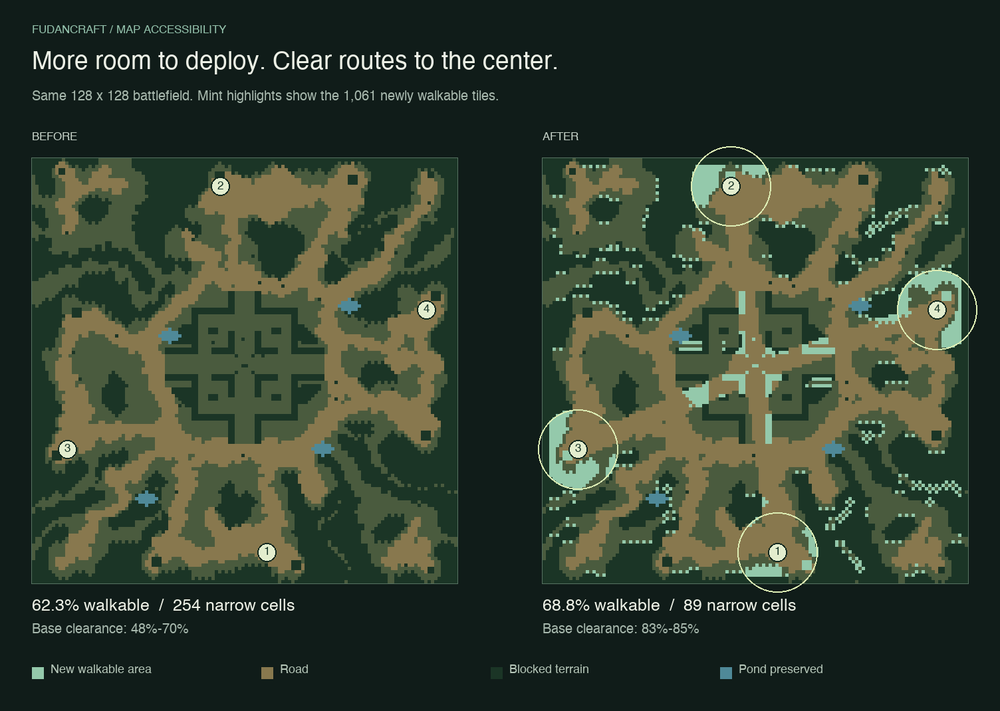
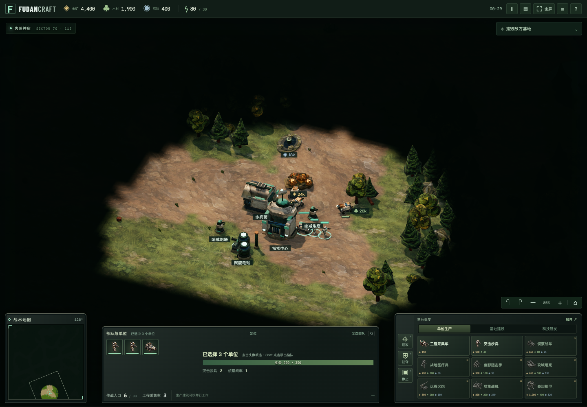
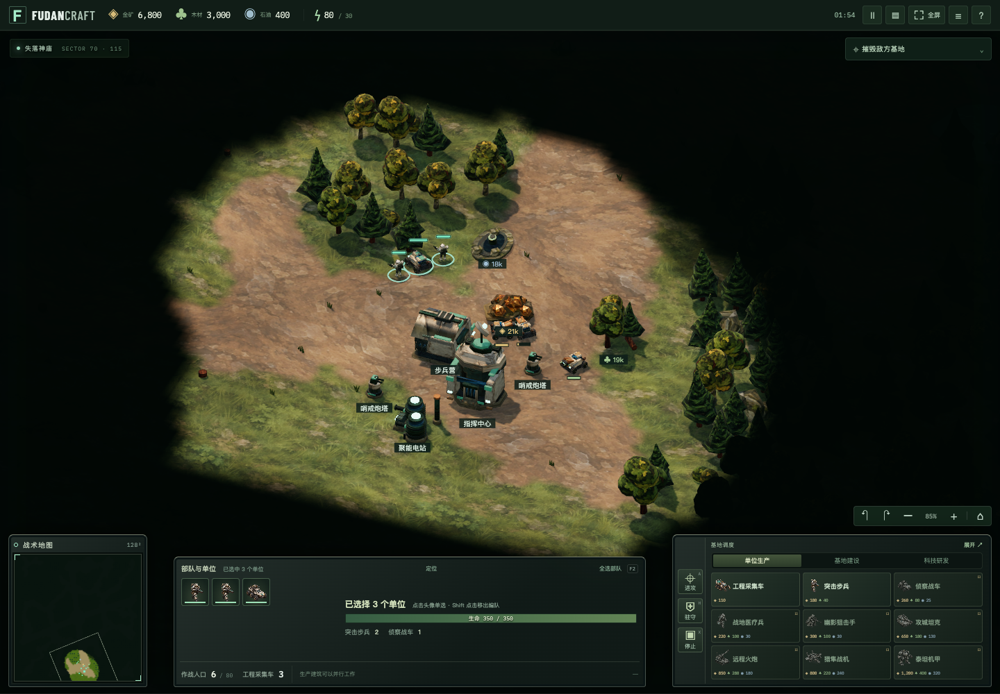

# 地图通行与基地空间调整

验证日期：2026-11-19。数值以 `world.ts` 的最终 `LAND`、`Engine.blockers()` 和实际模拟结果为准；原始 `map.ts` 保持不变。

## 原因与修改

地图为 128 × 128 格，每格 32 世界单位。九种移动单位的碰撞半径均为 14，直径 28，原本就能通过单格道路。拥挤主要来自基地周边森林、单格窄口、建筑间的小巷，以及所有兵种统一使用 64 的编队间距。

| 参数 | 当前值 | 源码位置 |
| --- | --- | --- |
| 基地集结区半径 | 384 | `src/game/world.ts` |
| 中央空地半径 | 256 | `src/game/world.ts` |
| 基地至中央道路半宽 | 96；栅格化前总宽 192 | `src/game/world.ts` |
| 单格窄口处理 | 在一次地形快照中识别，向阻挡的两侧各清一格 | `src/game/world.ts` |
| 建筑中心距离下限 | 双方建筑半径之和 + 48，原为 + 27 | `src/game/engine.ts`，`placementError` |
| 编队中心间距 | `clamp(最大选中模型 size × 0.65, 40, 60)`，原为固定 64 | `src/game/engine.ts`，`command` |
| 单位碰撞半径 | 14，保持原值 | `src/game/types.ts` |

基地空地保留草地，中央入口铺设道路；清理障碍后同步移除对应树木、灌木和大岩石。池塘与边界保留。新增的 `ROADS` 同时供 3D 地面、2D 地形和小地图使用。

另修正驻守单位旁的停靠点选择：替代空位必须能从当前侧直接抵达，避免单位绕到驻守者背后的空位后反复受阻。原有单格通道避让与碰撞检测仍保持有效。

## 测量

“可通行”统计 `LAND` 中的空格；“窄口”指空格的左右或上下相邻格同时阻挡，统计的是格子数量，不代表独立道路条数。基地统计取以指挥中心为圆心、半径 400、位于地图内的格子，并计入四方初始建筑与资源点的阻挡。

| 指标 | 调整前 | 调整后 |
| --- | ---: | ---: |
| 地形可通行格 | 10,208 / 62.30% | 11,269 / 68.78% |
| 最大连通区域格数（四邻接） | 10,137 | 11,160 |
| 单格窄口格数 | 254 | 89 |
| 计入建筑、资源后的可通行格 | 10,090 / 61.58% | 11,150 / 68.05% |
| 计入建筑、资源后的单格窄口 | 288 | 94 |
| 基地 1 可用空地 | 70.02% | 84.90% |
| 基地 2 可用空地 | 55.88% | 82.58% |
| 基地 3 可用空地 | 50.52% | 85.12% |
| 基地 4 可用空地 | 48.36% | 82.71% |

相对调整前的最终地形，新增阻挡为 0，新增可通行格为 1,061。仍保留少量与主区域不连通的边缘空地；表中总可通行面积不等同于所有部队都能抵达的面积。

原始指标：[map-layout-metrics.json](map-layout-metrics.json)。

## 验证

- `npm test`：71 项全部通过，包括 20 名步兵穿越单格窄口、20 辆采集车共享资源区、相向部队避让、建筑施工、存档与完整 AI 对局。
- `npm run build`：通过。Vite 仍提示 3D 分包超过 500 kB，这是现有体积提示。
- 四个出生点分别验证：每次将初始 6 个移动单位与新增的 3 名步兵、3 辆坦克编为一队，向中央入口移动。保留全部初始建筑和资源阻挡，暂停其他部队移动并禁用战斗伤害。四队均 12/12 抵达，用时 21.70 / 30.25 / 26.95 / 27.15 秒；每个模拟步检查均无穿墙，队内中心距离未低于 27.9。详见 [map-route-checks.json](map-route-checks.json)。
- 四方初始采集运行 60 秒：分别交付 2,300 / 1,900 / 2,300 / 2,200 资源，黄金与木材均正常到账。
- 浏览器中新建战役、选择部队、右键沿入口移动，确认 3D 画面、选中显示和小地图正常，未记录到页面错误。

地形清理对旧存档也生效；旧存档保存的建筑和资源位置不变。新开战役可体验完整的基地间距与新资源布局。

