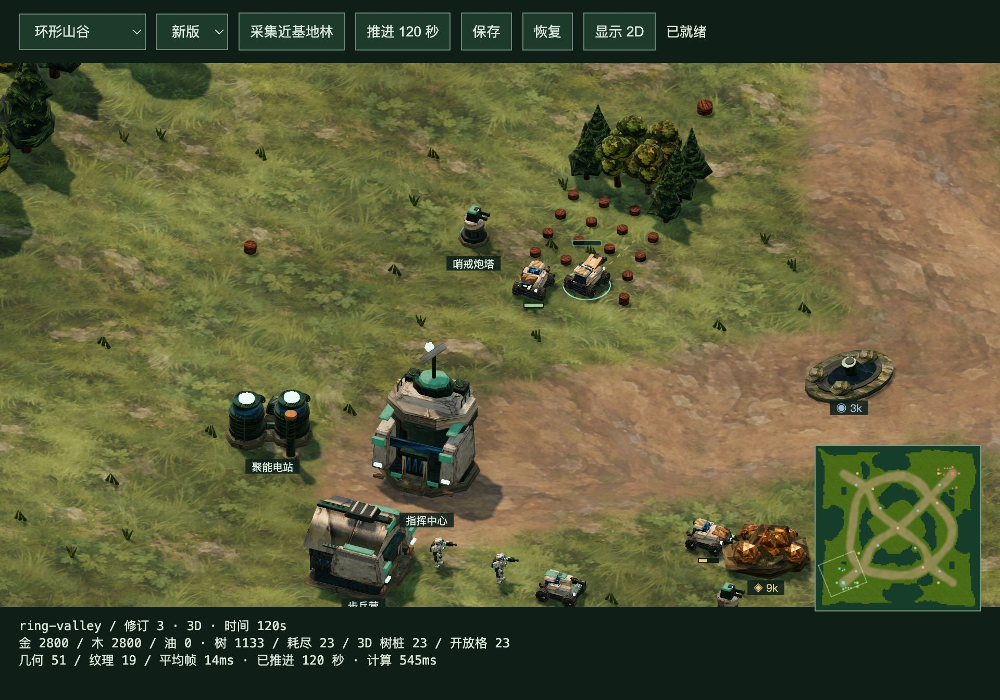
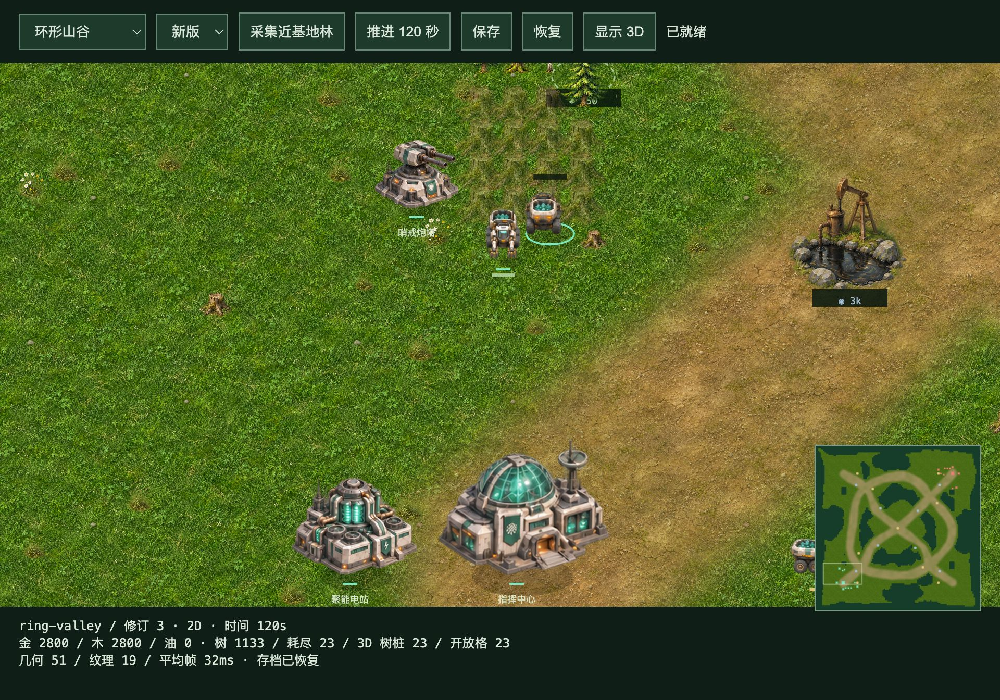

# 资源规则

数值与矿点锚点在 `src/game/resource-world.ts`，地图修订在 `src/game/world.ts`，采集与交付在 `src/game/engine.ts`。本页描述新局，旧存档按其修订号恢复。

## 数值

| 项目 | 金矿 | 木材 | 石油 |
| --- | ---: | ---: | ---: |
| 初始可用资源 | 1500 | 600 | 0 |
| 每个基地附近库存 | 10000 | 7200（24 棵） | 2600 |
| 每个出生区外围的前哨 | 4500 | 随周边林带 | 1500 |
| 单个扩张点 | 6000 | 每棵 300 | 1800 |
| 中心争夺矿（存在时） | 9000 | — | — |

- `[BANK]` 开局资源支持建设与补充采集车；精炼厂需要 550 金 / 280 木且不消耗油，可以从零油启动。战车工厂需要 800 金 / 360 木 / 80 油，必须先取得油料。兵种、建筑和升级以 `src/game/types.ts` 为准，调整说明见 `GAMEPLAY_RULES.md`。
- `[FINITE]` 库存不会自动补充。基地矿藏支持前期发展，扩张区与中心金矿提供后续资源；木材总量随实际森林密度变化。
- `[DELIVERY]` 基础采集速率 20 单位 / 秒，基础货舱 100；物流科技将货舱提升至 150，采集速率乘 1.5，木材加工厂另将木材速率乘 1.5。速率是作业时的速度，实际收入还取决于往返路径、占位与交付。资源运回己方指挥中心、精炼厂或木材加工厂后才计入银行。

## 各图库存

下表来自最新修订的 `Engine.state.nodes`，包含地图全部预设出生区，即使本局没有启用全部阵营。树木均包含在木材库存中，金矿数量包含中心争夺矿。

| 地图 | 修订 | 金矿 / 油井 / 树 | 总金 | 总油 | 总木 |
| --- | ---: | ---: | ---: | ---: | ---: |
| 失落神庙 | 5 | 13 / 12 / 1832 | 91000 | 23600 | 549600 |
| 环形山谷 | 6 | 13 / 12 / 2558 | 91000 | 23600 | 767400 |
| 碎石高地 | 6 | 13 / 12 / 657 | 91000 | 23600 | 197100 |
| 双湖边境 | 6 | 13 / 12 / 1356 | 91000 | 23600 | 406800 |
| 回音岛 · EI | 5 | 7 / 6 / 931 | 50000 | 11800 | 279300 |
| 扭曲草地 · TM | 5 | 13 / 12 / 2902 | 91000 | 23600 | 870600 |
| 海龟岩 · TR | 5 | 12 / 10 / 1378 | 82000 | 20000 | 413400 |
| 泰瑞纳斯看台 · TS | 5 | 7 / 6 / 1478 | 50000 | 11800 | 443400 |

## 森林与矿点

- `[TREE]` 每棵真实松树、橡树、白桦均绑定一个资源节点和原模型的树种、尺寸。树桩、草、灌木不提供木材。水中树干在地图生成时移除。
- `[HARVEST]` 点击密林内部时，采集车选择可达林缘；一棵树耗尽后继续寻找可达树木，装满后交付。最后不足整仓的木材也必须运回，不能丢失。
- `[LAND]` 森林阻挡格归属最近的真实树木；耗尽后留下树桩并释放其占地。同格重叠树全部耗尽后才开放。水、岩石和地图边界由永久障碍层保护。
- `[SITES]` 金矿与油井分别手工布点，取消公共三类资源捆绑与全局偏移。镜像矿点向中心吸附到格心，保持配对坐标；神庙非镜像基地按各自局部朝向校准扩张距离。所有矿点都在地面可达区域。
- `[SYMMETRY]` 初始建筑与采集车按基地朝向布置，近基地森林的数量和库存各方一致。地图本身的森林密度、路线曲折和未启用出生区仍构成战略差异。
- `[SPAWN]` 地面生产落点必须连入主矿所在的通路，避免单位出生于工厂背后的封闭空穴。采集移动保留重新寻路机制，解决 TS 回程持续等待。

## 渲染、存档与验证

- `[SSOT]` 寻路、建造预览、3D、2D 和小地图共用砍伐后的地形；3D 树木使用共享几何与材质，静态装饰不重复绘制资源树。小地图以地形显示森林，仅为金矿与油井绘制独立标记。
- `[SAVE]` 存档保留每棵树的剩余库存与绑定，节点上限 4096，并与对应修订的节点数量、身份、坐标、容量及树木绑定逐项验证。旧修订仍采用原布局，缺少修订号按修订 1 恢复；新资源规则仅用于新局。
- `[NETWORK]` 服务器维护库存与砍伐状态，快照仅提供已探索节点。联机回归验证新局的地图修订和每棵树 300 木材的储量。
- `[TEST]` `npm test` 共 108 项通过；资源专项 14 项覆盖八图 5 分钟收入差异小于 8%、镜像公共矿点路程差异小于 15%、TS 10 分钟采集、矿点可达、砍伐地形、尾货交付、存档篡改与历史兼容。`npm run build` 通过。
- `[BROWSER]` 实际 Renderer 核验山谷 120 秒耗尽 23 棵树，3D 树桩与开放格均为 23；点击剩余树冠成功下达采集命令。切换 TM 再恢复保留剩余库存与砍伐地形，2D 结果一致；TS 主页面保存后跨图读取恢复成功。经典四图新版森林与矿点均完成 3D 切图检查。
- `[LEGACY]` 浏览器山谷修订 2 / 3 反复切换并跨修订恢复，旧版保持 3600 / 1600 / 400 初始银行，新版恢复 1500 / 600 / 0；几何计数分别稳定回到 50 / 49，纹理保持 19，控制台没有页面错误。

以下为同一山谷战局砍伐后的实际 3D / 2D 画面。

自动回归衡量开局公平性与行为正确性；后期资源耗尽节奏仍需通过完整玩家对局观察。
