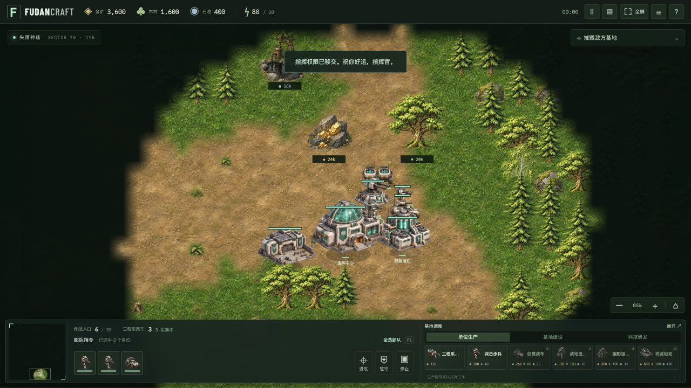
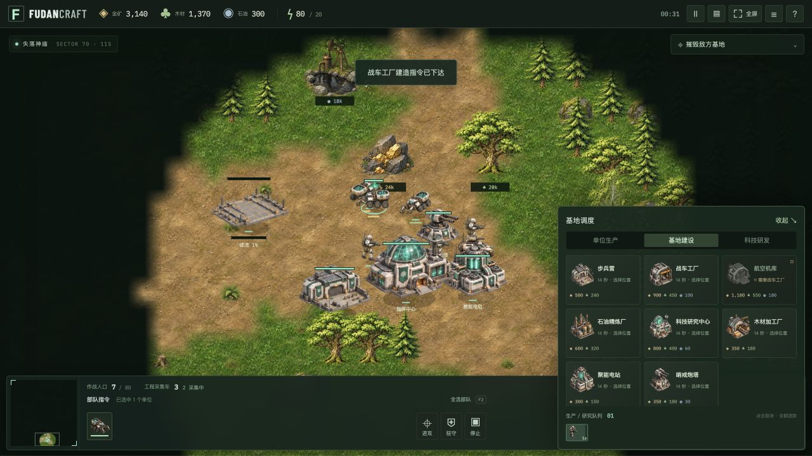

# FudanCraft 2.2：下一步评估

> 本文保留 2.2 的历史评估与截图。三项 P0 和首轮核心单位动作优化已在 2.3 落地，见 [实现说明](../MOTION_COMBAT.md)。下方探针和数据用于说明当时问题，不代表 2.3 当前结果。

日期：2026-11-18。范围：当前本地 Node + TypeScript 项目，开局选择、部队识别、生产与建造流程；另检查战斗、动画、AI、联机与加载代码。仅进行评估和记录，未修改游戏功能。

目前已经有统一风格和完整的采集—建造—研发—战斗循环，适合作为可玩原型。下一轮的主要价值在移动手感、动作与判定一致性、战场信息表达，随后再扩展战术与内容。

## 本轮实机流程

1. **开始战役与选择部队：基本顺畅，识别仍弱。** 能正常部署与全选，44 像素顶部和浮动底栏保留了战场面积。默认缩放下步兵偏小，初始部队与塔、电站重叠遮挡，阵营主要靠细小标记和血条识别；默认生产卡片名字被截断。应增强选中轮廓、遮挡时的单位提示、上下文信息和可调 UI 字号，保留紧凑布局。

2. **生产、选择建筑与放置：功能可用，状态解释不足。** 两名步兵排队、工厂放置和施工指派均成功，工程车自动分配。展开面板能显示建筑名、前置与费用，收起后占屏明显减少。仍可改进：按建筑组织队列、区分缺资源/缺科技/缺电、显示各资源工人数与产率、明确低电力停产原因。当前顶部电力显示容量 80 / 已用 20，建议改为已用 20 / 容量 80并加明确标签。截图里的小字、弱化锁定卡片与费用符号有可读性风险。

本轮还观察到 AI 出击和 02:21 的失败结算。这局只排了两名步兵并建工厂，没有持续补兵或微操，因此不能据此评价难度公平或兵种平衡。结算仅用时、击毁、损失三个数值，对复盘帮助有限。

## 已复现的正确性和手感问题

2.2 当时使用 `node --import tsx docs/audit-2026-11-18/probes.ts` 复现；历史结果保存于 [probe-results.json](probe-results.json)。

| 优先级 | 发现与依据 | 建议与验收方向 |
| --- | --- | --- |
| P0 | 采集车最小中心距离约 1.6，而两车逻辑半径之和为 28。`engine.ts` 的移动只沿路径积分，阻挡图不包含行进单位。终点分散不能解决途中重叠。 | 增加局部避让、间距约束、采集与交付槽位。用二十辆车和窄路场景验证不穿叠、不卡死、拥堵能恢复。 |
| P0 | 攻击事件产生当步即扣血，弹道仍有剩余生命。单步 50 ms 的隔离复现已扣 9 HP，视觉弹道仍存活。 | 为不同武器定义清楚的发射和命中时刻；炮弹在命中时结算，开火、受击、死亡按事件顺序播放。即时命中武器也要让视觉与判定一致。 |
| P0 | 敌方装甲兵实际满血 118.75；对方科技被视图过滤后，当前客户端 `maxHp()` 算成 95。 | 公开单位必要的最大生命值或公开修正后的状态，同时保留科技隐私。验证未升级、升级和受伤敌人的血条比例。 |

## 后续投入顺序

| 顺序 | 方向 | 具体工作与收益 |
| --- | --- | --- |
| 1 | 单位动作连贯性 | 当前待机两帧、移动四帧、攻击/阵亡各两帧，仍直接切换。以实际移动距离驱动步态，加入起停和转身过渡；先精修步兵、采集车、坦克三类。美术统一脚底、尺度和轮廓；需要新增帧时先校验连贯性。坦克车体与炮塔可拆层。 |
| 2 | 战斗可读性与音效 | 增强敌我轮廓、选择反馈、目标指示、受击和死亡提示；武器弹道与音色区分步枪、坦克、火炮。现有音效以操作语音和出兵提示为主。颜色之外增加形状提示，避免仅凭血条颜色识别阵营。 |
| 3 | 调度与新手反馈 | 补 Shift 指令队列、巡逻/护送、编队状态、资源工人分配和一键处理空闲工人。已有编队快捷键、F3、集结点和攻击移动应继续保留。新手引导应让玩家实际完成采集—建厂—出兵—交战，并解释停产原因。 |
| 4 | 冷启动与大规模性能 | 当前 `Renderer.load()` 一次加载二十张 PNG，磁盘源文件合计约 50.1 MiB，按 RGBA 像素估算约 120 MiB，另有地表和其他画布。优先按需加载、压缩资源、画质档位和特效预算；为 2–4 人、80 人口/方、不同缩放做实测。该估算不是实际 GPU 或进程峰值。 |
| 5 | AI、公平与兵种平衡 | AI 经济与玩家相同，但进攻决策直接读取全状态中的敌方基地位置；难度主要改变出击时间/集结数量。加入侦察、信息记忆、护矿、撤退与针对敌军构成的生产，再用多种地图和对局统计校准兵种价值。不能凭一局或单看 DPS 判定平衡。 |
| 6 | 有战术作用的地图 | 目前主要是通行/阻挡，视野是圆形，攻击按距离判断。明确直射武器视线、树林/岩石遮挡和曲射例外，再考虑高地、隘口、桥梁、地表速度、可争夺矿点。地形应影响决策。 |
| 7 | 完整对局体验 | 联机断线目前立即转 AI，缺少原席位重连；房间不持久化。增加重连与状态恢复、回放/战报、资源和科技时间线、多地图与目标模式。不同阵营和更多兵种适合在基础手感与定位稳定后投入。 |

## 建议的下一轮范围

先修三项 P0，再精修步兵、采集车、坦克的移动与攻击。这一轮以“二十单位能顺畅穿过窄口、不在采集点叠堆；开火—命中—扣血—死亡一致；升级后的敌方血条正确”为验收条件。随后做敌我识别、受击音效和调度反馈，再扩展地形战术与 AI。

## 验证与限制

- 当前五十项自动化测试通过；没有新增功能或修改规则。这些缺陷在测试通过时仍可复现，说明需要增加相应回归场景。
- 图像证据均来自本轮生产构建的实机页面，1280×720；保存后检查了本地文件。控制台未捕获到错误。
- 本轮没有进行弱网/断线、低端设备、四方满人口、长时间内存、触屏、屏幕阅读器或完整对比度检测。可读性/颜色风险不是完整无障碍合规结论。
- 动作和判定结论还依据源码与内存复现；静态截图不能证明动画连续性、帧率或武器平衡。当前没有批量对局统计，AI 与兵种建议属于待验证改进方向。
