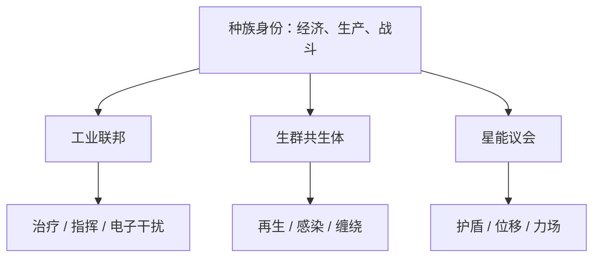
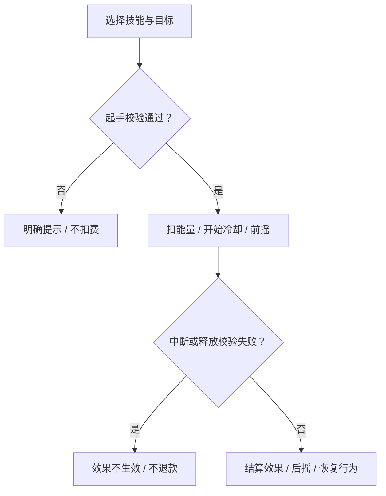

# FudanCraft 三种族与技能系统详细设计

> 设计稿 v0.1 · 2026-11-21 · 状态：待评审，尚未实现
>
> 本文依据当前源码与本次讨论编写。**当前行为以源码为唯一事实来源；新增行为均为设计提案，不代表游戏已经具备这些能力。** 新数值统一标记为“参数草案〔Assumption, TBD〕”，用于形成可测试的初始版本，不是实测平衡结论。种族与新增单位名称均为暂名。

## 01 · 设计目标与当前基线

### 1.1 产品目标

面向希望研究配兵、科技路线和操作时机的 RTS 玩家，将 FudanCraft 扩展为三个种族具有不同经济组织、生产方式与作战机制的游戏。技能系统覆盖治疗、增益、减益、控制、区域控制和位移，使玩家能够通过侦察识别对方组合，再调整部队与技能使用。

核心体验从选择种族开始，经由发展经济、建设供给、解锁部队与技能，进入侦察、交战、撤退补充和转型的循环。一次战术决策应有可见结果：治疗保存了单位，净化解除限制，控制争取了射击时间，分散阵型避开了范围技能，或击杀辅助破坏了对手协同。对局胜负仍沿用摧毁敌方指挥中心的规则。

### 1.2 已确认的设计方向与本文范围

用户明确希望增加建筑、科技、兵种数量和复杂度，引入多个种族、人口限制，以及治疗、增益、减益和控制单位。本文完整覆盖三个种族的机制设计，并详细定义 **9 个核心支援／控制单位、18 项技能、4 条统一设计规则**。

建筑、科技与人口在本文中定义到能够支撑技能玩法的程度。此前讨论的“每族约 12 种建筑、12–15 种单位、10–15 项科技”属于规模设想，不作为凑数指标。本文不声称已经完成所有作战单位的价格、普通攻击、模型和完整科技目录；这些内容应依据本稿确定的角色继续展开。

### 1.3 当前实现与本次变化

| 主题 | 当前源码事实 | 本文新增设计 |
| --- | --- | --- |
| 阵营 | 玩家有阵营与队伍，未定义种族字段；各方共享单位、建筑和科技 | 三种族使用不同生产组织、供给载体与技能体系 |
| 内容规模 | 10 类建筑、9 类移动单位（含工人）、5 项科技 | 保留工业族基础，扩展另外两族及专门支援角色 |
| 人口 | 最多 80 个移动单位；队列内单位也计入，每个单位权重相同 | 带权重的人口、可损失的供给容量、排队预留 |
| 医疗 | 医疗兵自动治疗受伤的友方地面作战单位，单次 10 生命；不能攻击 | 保留基础自动治疗，增加主动净化；另外两族分别侧重再生与护盾 |
| 战斗差异 | 狙击手对特定步兵额外伤害；坦克与火炮有溅射且不能对空 | 通过状态、范围、目标标签和施法时机补充差异 |
| 技能基础 | 当前命令没有通用主动施法；单位没有通用能量、状态和技能冷却 | 定义统一的施法、能量、状态和反馈规则 |

上述事实对应来源 [1](#source-1)、[2](#source-2)、[3](#source-3)、[4](#source-4)。当前医疗可以作用于坦克等地面机械单位；本文保留这一兼容范围，不在本次设计中另加生物／机械治疗限制。

## 02 · 四条统一设计规则

### RULE-01 · 分配操作复杂度

**普通单位承担基础战斗，少量关键单位承担需要判断时机的技能。**

普通单位以普通攻击、被动效果或自动技能为主；常规作战单位原则上最多 1 个主动技能，核心施法单位最多 2 个主动操作入口。医疗的基础治疗允许自动执行，净化、位移、区域封锁等高影响技能由玩家决定。本文三个种族各选 3 个关键单位建立技能协同，不要求每支部队同时操作全部施法者。

`[RULE-01-AUTO]` 自动行为不能打断玩家的移动、主动施法或撤退命令。自动治疗只在空闲、驻守或攻击移动且未交战时发生，不为了追赶伤员擅自离开当前位置。高影响技能初始默认关闭自动施法。

`[RULE-01-GROUP]` 同类施法者多选时，一次点击默认只派出一名可用施法者；不会让整个编队同时向同一点重复释放。施法者选择规则见 UI-02。

可观察判据：玩家只使用编队移动和攻击，也能形成基本军队；加入一个辅助后，通过一个关键操作就能改变局部交战。新技能如只有反复点击才能维持基础数值，应先改为被动或自动机制。

### RULE-02 · 区分科技与技能

**科技负责长期成长与能力解锁；技能负责战场上的局部、临时优势。**

`[RULE-02-UNLOCK]` 科技研究完成后，为已有及以后生产的适用单位解锁能力；单位仍须满足能量、冷却、距离、目标和状态条件。研究完成不回满能量、不重置冷却、不自动施放技能。

`[RULE-02-TIMING]` 每条路线都必须有投入窗口：研究消耗经济与时间，施法消耗单位在场、位置、人口和能量。三族不共享“点完某个全军伤害升级才能进入全部高级分支”的统一门槛。

`[RULE-02-PERSIST]` 已完成的科技不会因研究建筑被摧毁而遗失；未完成的研究按既定退款规则取消。分支间允许后续转型，不设永久互斥科技。已存活施法者也不会因研究建筑或能量供给设施被摧毁而丢失已解锁技能。

可观察判据：同样研究了净化的双方，仍会因为辅助位置、剩余能量和施法顺序而产生不同结果。

### RULE-03 · 明确叠加和控制规则

**同类效果有上限，连续控制有恢复窗口，支援效果必须承担成本。**

`[RULE-03-STACK]` 同组增益或减益只取最强值；不把持续时间相加，不把多个相同护盾合并成超大盾。独立状态保留各自剩余时间，最强状态失效后，仍有效的较弱状态才接替。

`[RULE-03-CONTROL]` 定身属于强行动控制；初版不提供范围长眩晕。定身结束或被提前解除后，目标获得短时定身抗性。沉默单独设恢复保护，避免用轮流施法把单位持续封锁。具体数值与例外见状态规则。

`[RULE-03-COST]` 施法者占人口，主动技能消耗个人能量并进入冷却。大量辅助会压缩主力数量；集火施法者、分散、逼空技能和切断补充都是有效应对。

可观察判据：两个相同辅助不能无限叠加同一增益；三个控制单位不能无间隙定住同一目标；多族盟军不能绕过同组限制。

### RULE-04 · 让效果可辨认

**玩家必须能看出技能何时生效、影响谁、持续多久，以及如何应对。**

`[RULE-04-READ]` 技能提供施法前兆、目标或区域预览、生效反馈、状态图标与持续时间。减速、定身、沉默、易伤、治疗抑制分别使用独立图形和文字，不只依靠颜色区分。

`[RULE-04-FOG]` 信息反馈遵守战争迷雾。玩家知道己方单位正在受到什么影响；只有在己方视野内才能看到敌方施法者和具体施法动作。状态图标不会标出迷雾中的敌人位置。

`[RULE-04-FAIL]` 未解锁、能量不足、冷却、射程不足、目标不适用和自身被沉默分别给出明确提示。涉及不可见敌方目标时只显示“目标不可用”，不泄露死亡、移动或隐蔽状态。

可观察判据：玩家能通过战场与选中面板判断一次施法为何成功或失败；触屏玩家不用依赖鼠标悬停也能读取完整技能说明。

## 03 · 三种族的机制分工

| 维度 | 工业联邦〔暂名〕 | 生群共生体〔暂名〕 | 星能议会〔暂名〕 |
| --- | --- | --- | --- |
| 作战主题 | 稳定阵型与协同火力 | 恢复、感染与持续追击 | 护盾、位置调整与空间控制 |
| 生产组织 | 多生产建筑并行；本地专精模块决定该建筑可生产的进阶单位 | 孵化巢共享工人与基础军队生产槽；新增孵化巢增加槽位 | 单位由独立设施生产；设施需要处于能量节点覆盖内 |
| 建造方式 | 工人在现场施工与维修 | 工蜂驻留培育建筑，完工后恢复工作 | 工匠完成启动后建筑自行构筑，失去覆盖则暂停 |
| 供给载体 | 补给站 | 不具攻击能力的供给囊体 | 能量节点，同时提供生产覆盖 |
| 主要续航 | 持续治疗、维修与即时净化 | 再生与代谢净化 | 可恢复护盾、临时屏障 |
| 强项 | 阵地推进、支援集中、干扰敌方辅助 | 消耗后恢复、减速追击、迫使敌人分散 | 吸收爆发、救出关键单位、区域禁入 |
| 暴露的弱点 | 辅助较慢、撤离展开位置有成本 | 群体受范围伤害压力，回复被抑制时难换血 | 单位与支援昂贵，护盾破除后补充困难 |
| 核心决策 | 何时维持火力阵型，何时烟幕撤离 | 何时持续接触，何时脱离等待恢复 | 护盾留给谁，位移和力场何时使用 |

`[RACE-IDENTITY]` 三族拥有处理常见威胁的办法，但不要求逐一复制同名技能。工业族无瞬移，生物族无护盾，能量族无持续生命治疗；净化与反控制通过不同角色和成本提供。

图 1：三个种族的支援机制分工。具体施法者、限制和反制见第 06–08 章。

## 04 · 通用技能机制

### 4.1 标识、对象与单位

`[SKILL-01]` 每个技能只有一个稳定 ID；本稿使用 `IND-*`、`BIO-*`、`ENE-*`。中文名称可以调整，规则与界面通过 ID 对齐。每个技能必须定义施法者、解锁条件、目标、距离、范围、能量、冷却、前摇、效果、持续时间、中断、叠加和反制；共用规则由本章统一定义。

| 术语 | 本文唯一含义 |
| --- | --- |
| 能量 | 单位个人的施法资源；与工业族建筑电力、星能族建筑覆盖分开 |
| 生命回复 | 治疗、再生以及恢复生命的被动效果；受治疗抑制影响 |
| 护盾 | 先于生命吸收伤害的原生护盾；最大值来自单位参数 |
| 临时护盾 | 技能创建的有期限护盾，独立于原生护盾 |
| 净化 | 移除友方的可净化负面状态 |
| 驱散 | 移除敌方的可驱散正面状态；不会撤销永久科技或天生护盾 |
| 地面作战单位 | 地面移动单位，排除工人和供给囊体；包含机械与生物 |
| 友方 | 己方与同队盟友；可受友军支援，但盟友不能被越权移动或下令 |
| 世界单位 | 当前地图中的距离单位；1 地形格为 32 世界单位 |

`[SKILL-02-RANGE]` 单位目标射程按施法者中心到目标碰撞体边缘的距离判断；点目标按施法者中心到落点距离判断。圆形范围按目标中心是否落入范围判断，与单位体型无关。本文的圆形范围数值均为半径。

`[SKILL-03-TARGET]` 治疗、增益、减益和控制默认不作用于建筑、资源或尸体。工人、供给囊体、空中单位是否可被某技能作用，以各技能目标表为准。“友方”默认包括施法者自己，技能另有排除时服从该限制。常规范围效果不伤友军；力场对通行的影响是明确例外。

### 4.2 个人能量与冷却

| 参数 | 参数草案〔Assumption, TBD〕 | 约束 |
| --- | --- | --- |
| 核心施法者最大能量 | 100 | 不受攻防科技放大 |
| 生产完成时能量 | 50 | 不以满能量快速补充全部技能 |
| 恢复速率 | 每秒 0.8 | 存活时持续恢复；定身、沉默不停止恢复 |
| 能量上限处理 | 超过最大值的恢复丢弃 | 不转换为生命或其他资源 |
| 手动技能后摇 | 0.2 秒 | 完成后才恢复普通攻击／自动技能 |
| 时间基准 | 游戏内秒 | 暂停时所有恢复、状态和冷却同时暂停 |

`[SKILL-04-RESOURCE]` 手动技能通过起手校验后，在前摇开始时一次性扣除能量并启动该技能冷却。前摇开始前的取消或无效指令不扣费。前摇中被打断、主动取消或目标失效，已扣能量不退，冷却继续。

技能间冷却独立；同一单位不能同时施放两个技能，也不能在前摇期间普通攻击或执行自动治疗。研究完成、变更自动施法开关、保存和读取都不能重置能量或冷却。

### 4.3 施法流程与失败恢复

图 2：通用手动施法流程。自动治疗的结算周期见 IND-01，不使用个人能量。

| 阶段 | 处理规则 | 可见结果 |
| --- | --- | --- |
| 选择 | 查看技能并进入目标预览；Esc／取消按钮退出 | 不扣能量、不改变单位命令 |
| 起手校验 | 己方可操作、存活、已解锁、未冷却、能量足、未沉默；目标有效且在当前视野和射程内 | 不通过则留在目标模式，显示失败原因 |
| 距离不足 | 初版不自动走入射程，也不保存“追着目标施法”的隐式命令 | 显示射程圈，玩家先移动再施法 |
| 前摇 | 单位停止移动，显示施法动作与目标标记 | 可以被规定的打断效果中断 |
| 释放校验 | 再次检查单位存活、目标阵营／视野／射程以及技能要求 | 目标失效则不生效，保留费用与冷却 |
| 结算 | 单体以释放时目标状态结算；区域以固定落点和释放时单位位置结算 | 命中、净化、护盾或区域反馈 |
| 完成 | 后摇结束，恢复之前的驻守、空闲或攻击移动命令 | 不自动重复手动技能，不追入迷雾 |

`[SKILL-05-INTERRUPT]` 死亡、沉默、强制位移、玩家重新下达移动／停止／其他动作，会中断尚未释放的手动技能。定身只阻止位置变化，不中断原地治疗和普通施法；点名的位移技能属于例外。前摇中输入其他技能仅提示“正在施法”，不暗中替换；移动或停止是明确取消方式。

`[SKILL-06-AREA]` 持续区域在地面生成后独立存续，施法者死亡不会自动删除。离开区域后，依靠区域存在的效果立即结束；区域附带的离场延续时间必须单独注明。点目标必须在当前己方视野内；区域生成后可以影响进入区域的隐蔽敌军，但不得因此暴露单位位置或提供隐藏命中名单。

`[SKILL-07-VALIDATION]` 净化要求至少一个可移除负面状态；原生护盾充能要求护盾未满；临时护盾遵守 COMBAT-03，无临时护盾的单位允许在满血时预先授盾。目标是否满足隐藏条件，不得通过不同错误文本泄露信息。攻击性技能允许对可见且标签适用的目标施放，即使最终收益为零；解构脉冲不公开目标的实际能量余额。

`[SKILL-08-LIFECYCLE]` 无复活、单位控制权转移、运输收纳或召唤单位机制。状态与能量只随单位存活；同一帧出现互斥结果时，以权威战局的既定结算顺序为准，死亡单位不接受后续治疗。联机端不能各自决定命中或扣费。

## 05 · 状态、叠加与反制规则

### 5.1 状态目录

以下数值均为参数草案。技能引用状态组，不能自行绕开组上限。

| 状态组 / ID | 效果与上限 | 清除方式 |
| --- | --- | --- |
| 攻速增益 `BUFF_ATTACK_SPEED` | 同组取最高，最高 +25%；只影响普通攻击间隔 | 敌方驱散、自然到期 |
| 移速增益 `BUFF_MOVE_SPEED` | 同组取最高，最高 +20% | 敌方驱散、自然到期 |
| 减速 `DEBUFF_SLOW` | 同组取最高，最高降低 40% 移速 | 净化、离开施加区域或自然到期 |
| 易伤 `DEBUFF_EXPOSED` | 同组取最高，最高承受伤害 +20% | 净化、自然到期 |
| 治疗抑制 `DEBUFF_HEAL_CUT` | 同组取最高，最高降低 50% 生命回复 | 净化、自然到期 |
| 感染伤害 `DEBUFF_INFECTION` | 同组只应用最高每秒伤害，不叠加多个感染源 | 净化、自然到期 |
| 再生 `BUFF_REGEN` | 同组取最高，每秒回复上限 12 | 驱散、自然到期；仍受治疗抑制 |
| 定身 `CONTROL_ROOT` | 移速为 0，禁位移；可攻击、施法、受治疗 | 净化、自然到期 |
| 沉默 `CONTROL_SILENCE` | 禁主动技能并打断手动前摇；不禁普通攻击、被动与基础自动治疗 | 净化、自然到期 |
| 临时护盾 `BUFF_BARRIER` | 单目标只保留一个实例，不累加剩余盾值 | 驱散、耗尽、自然到期 |
| 单体远程减伤 `BUFF_RANGED_GUARD` | 同组取最高，上限 20%；不影响范围伤害与持续伤害 | 离开区域；区域存在时不可单体驱散 |
| 定身／沉默抗性 `CONTROL_GUARD` | 对指定控制免疫，不免其他减益 | 自然到期；不能驱散 |

`[STATUS-01-STACK]` “取最高”按实际数值选择，平值按较晚到期者提供效果；同一个技能来源再次施加时刷新为该次完整时长，不相加。不同来源的到期时间分别前进，禁止把被覆盖状态冻结后依次排队生效。

`[STATUS-02-DURATION]` 持续状态在有效时间内按游戏时间累计；伤害／回复从施加后开始，不额外赠送起手一跳或结束一跳。例如每秒 10、持续 6 秒的再生总上限为 60，提前移除则按实际持续时间结算。

### 5.2 连续控制保护

`[CONTROL-01]` 每次有效定身结束或被净化后，目标获得 3 秒定身抗性。正在定身或处于定身抗性时，再次定身无效且不刷新时间。该抗性不阻止减速、沉默或伤害。

`[CONTROL-02]` 每次有效沉默结束或被净化后，目标获得 3 秒沉默抗性。沉默不叠加、不刷新；不能靠多个施法者将同一目标持续封锁。

`[CONTROL-03]` 两类抗性独立，允许定身与沉默同时存在，但各自解除和恢复保护仍独立。初版最长单次定身 1.5 秒、沉默 2 秒；不加入眩晕、恐惧、魅惑或概率打断。后续新增强控制必须纳入同一保护体系。

`[CONTROL-04]` 控制免疫状态不可驱散。常规单位没有“机械天然免控”或“高级单位天然免控”的隐藏规则。飞行、建筑等适用边界由技能目标类型表达。

### 5.3 净化与驱散顺序

`[DISPEL-01]` 净化移除最优先的负面状态实例，优先级为：定身 → 沉默 → 治疗抑制 → 易伤 → 感染伤害 → 减速；同级选剩余时间最长者，再按稳定状态 ID 排序。复合技能生成的感染与治疗抑制是两个独立实例，净化一个不自动移除另一个。

`[DISPEL-02]` 驱散的优先级为：临时护盾 → 攻速增益 → 移速增益 → 再生；同级同样选择剩余时间最长者。永久科技、原生护盾、供给能力和建筑覆盖不可驱散。

`[DISPEL-03]` 地面区域不能通过净化目标删除。净化可以清除一次可净化的区域减速，但只要目标仍站在区域内，减速下一次结算即恢复；界面提示“离开区域才能持续解除”。保护抗性例外：区域不能重新定身处于抗性的单位。

### 5.4 伤害、生命与护盾

`[COMBAT-01]` 普通攻击的伤害基数来自单位与永久科技；技能伤害基数来自技能。当前精密武器的普通攻击加成不自动放大感染伤害、治疗、护盾、能量损失或技能持续时间。

单次伤害依次应用该伤害原本的目标与距离修正、最高易伤、适用的最高减伤，再依次扣除临时护盾、原生护盾、生命。无随机暴击。技能注明“扣能量”“削减护盾”的直接数值变化不属于伤害，不触发易伤或减伤，也不溢出到生命。

`[COMBAT-02]` 生命回复量等于基础回复量乘以 `(1 − 治疗抑制比例)`，再受缺失生命限制。多个直接治疗者可以共同治疗，但一个目标每秒来自直接治疗的总量上限为 20；再生另受每秒 12 的状态上限，两者都受治疗抑制。未产生的过量回复不转移、不溢出。

`[COMBAT-03]` 临时护盾不增加最大生命，也不触发“按生命百分比”的治疗优先级。没有临时护盾时可直接授盾，包括满生命目标；再次授盾时，只在新盾值高于当前剩余盾值，或旧盾剩余时间小于 1 秒时允许替换；替换覆盖旧值与剩余时间，旧实例彻底删除，不在新盾结束后恢复。否则友方授盾在起手时拒绝，不扣费。

`[COMBAT-04]` 星能族作战单位可以有原生护盾，其生命／盾值分配逐单位制定。原生护盾在连续 6 秒未受到任何敌方伤害或直接护盾削减后，以每秒最大护盾的 4% 恢复。治疗抑制不影响原生护盾恢复或临时授盾；敌方可用护盾削减、驱散临时护盾、持续伤害延迟自然恢复。

`[COMBAT-05]` 移速按基础速度乘以 `(1 + 最高移速增益) × (1 − 最高减速)` 计算，定身直接置 0。攻速 +20% 表示普通攻击间隔除以 1.2，不缩短前摇、技能冷却、治疗周期或生产时间。

## 06 · 工业联邦：治疗、指挥与电子干扰

### 6.1 种族机制与部队关系

保留现有工程车、步兵、侦察车、狙击手、坦克、火炮、战机与机甲作为工业族基础。三类支援分别承担持续保存部队、组织火力窗口、打断敌方辅助。工业族仍有全局建筑电力；电力不足影响生产与研究，不影响已出场单位施法。

工厂专精模块是挂在单座工厂上的生产扩展：装甲模块服务重型部队，支援模块服务干扰单位。同一工厂只能选择一个模块；换装时该工厂暂停生产，其他工厂不受影响。已有单位保留，不因换装退化。模块的完整造价另行平衡，不作为技能生效条件。

| 单位 / ID | 定位与人口草案 | 生产与可用阶段 | 操作复杂度 |
| --- | --- | --- | --- |
| 战地医疗兵 `IND-MEDIC` | 持续治疗／净化，2 人口 | T1 步兵营；建成战地医务所后可训练 | 自动治疗 + 1 主动 |
| 战术指挥官 `IND-COMMANDER` | 火力增益／掩护撤退，3 人口 | T2 步兵营；需要指挥所 | 2 主动 |
| 电子干扰车 `IND-DISRUPTOR` | 单体易伤／范围技能封锁，3 人口 | T2 战车工厂及支援模块 | 2 主动 |

### 6.2 战地医疗兵

#### IND-01 · 战地治疗

| 属性 | 设计 |
| --- | --- |
| 解锁 | 单位出场自带，默认自动开启 |
| 目标 | 友方受伤地面作战单位；排除自身、工人、供给囊体与空军 |
| 参数草案 | 射程 170；单次治疗 10 生命；周期 1 秒；治疗动作前摇 0.16 秒；不消耗能量 |
| 效果 | 选择当前生命比例最低的可治疗单位；同值选距离近者，再按单位 ID |
| 限制 | 治疗时停止移动；手动移动、净化或停止立即优先；适用 COMBAT-02 |
| 反制 | 治疗抑制、范围伤害、切后排；沉默不关闭基础自动治疗 |

这是对现有医疗兵行为的延续，但加入统一的直接治疗上限与状态反馈。目标在治疗前摇内死亡、离开射程或恢复满血，本次治疗取消，不额外产生治疗。

#### IND-02 · 应急净化

| 属性 | 设计 |
| --- | --- |
| 解锁 | T2 医疗协议，战地医务所研究 |
| 目标 | 友方地面作战单位，包括自身 |
| 参数草案 | 射程 240；能量 25；冷却 12 秒；前摇 0.25 秒 |
| 效果 | 按 DISPEL-01 移除 1 个可净化负面状态 |
| 限制 | 自身被沉默时不能自救；移除定身／沉默后触发对应抗性；无可移除状态时不起手 |
| 反制 | 先施加高优先级减益诱导净化，再切入；也可直接控制医疗兵 |

### 6.3 战术指挥官

#### IND-03 · 集中火力

| 属性 | 设计 |
| --- | --- |
| 解锁 | 单位出场自带 |
| 目标 | 以自身为中心，友方地面作战单位 |
| 参数草案 | 半径 220；能量 40；冷却 20 秒；前摇 0.35 秒；持续 6 秒 |
| 效果 | 释放时范围内的适用单位获得普通攻击速度 +20% |
| 限制 | 无需持续留在指挥官附近；同组不叠加；不加快技能、治疗或产能 |
| 反制 | 驱散关键单位增益，暂时拉开距离，范围伤害打击集中站位 |

#### IND-04 · 掩护烟幕

| 属性 | 设计 |
| --- | --- |
| 解锁 | T2 掩护战术，指挥所研究 |
| 目标 | 当前视野内的地面位置 |
| 参数草案 | 射程 300；半径 140；能量 40；冷却 24 秒；前摇 0.4 秒；区域存在 5 秒 |
| 效果 | 烟幕内友方地面作战单位承受的单体远程普通攻击伤害降低 20% |
| 限制 | 不遮战争迷雾、不制造随机未命中；不降低近战、范围或持续伤害；离场即失效 |
| 反制 | 炮火与区域技能、绕行、等烟幕结束；不能对单个受益者驱散烟幕 |

### 6.4 电子干扰车

#### IND-05 · 弱点标定

| 属性 | 设计 |
| --- | --- |
| 解锁 | 单位出场自带 |
| 目标 | 可见敌方地面作战单位 |
| 参数草案 | 射程 300；能量 30；冷却 14 秒；前摇 0.35 秒；持续 5 秒 |
| 效果 | 目标承受伤害 +15%，适用易伤组 |
| 限制 | 不标记建筑；不提供迷雾追踪；与生物族腐蚀取最高，不相乘 |
| 反制 | 净化、撤离火力区、临时护盾吸收集火 |

#### IND-06 · 电磁封锁

| 属性 | 设计 |
| --- | --- |
| 解锁 | T3 电磁协议，指挥所研究 |
| 目标 | 当前视野内的地面位置；影响敌方地面作战单位 |
| 参数草案 | 射程 300；半径 120；能量 50；冷却 26 秒；前摇 0.6 秒 |
| 效果 | 范围内目标沉默 2 秒，并各削减最多 40 点原生护盾 |
| 限制 | 无原生护盾也可被沉默；不扣个人能量、不伤生命、不削临时护盾；适用沉默抗性 |
| 反制 | 看到明显脉冲预警后分散；净化沉默；用主动位移提前躲开 |

工业族组合例：坦克保护医疗兵，指挥官在接战时提供火力窗口，干扰车标定重点目标。对方可以绕过坦克处理辅助，或用范围伤害迫使工业军队放弃密集阵型。三种辅助齐备也不保证更强，因为它们合计占用人口且消耗同一经济预算。

## 07 · 生群共生体：再生、感染与缠绕

### 7.1 种族机制与部队关系

生群以孵化巢提供生产槽，工人与基础军队争用槽位；增加孵化巢提升补充能力。高级单位由相应进化建筑解锁，仍消耗正常资源与人口，不免费从伤亡中生成。

前线单位围绕快速近战、远程消耗和笨重攻坚分工。再生使撤退有收益，感染抑制敌方续航，缠绕帮助追击。初版不额外加入地毯式地表蔓延和召唤海，避免与区域技能、供给单位同时产生难以读取的战场对象。

| 单位 / ID | 定位与人口草案 | 生产与可用阶段 | 操作复杂度 |
| --- | --- | --- | --- |
| 育生者 `BIO-NURTURER` | 再生／净化，2 人口 | T1 孵化巢；需要育生池 | 2 主动 |
| 感染者 `BIO-INFECTOR` | 感染／腐蚀，3 人口 | T2 孵化巢；需要感染腺巢 | 2 主动 |
| 缚地兽 `BIO-BINDER` | 定身／区域减速，3 人口 | T2 孵化巢；需要缚地巢 | 2 主动 |

### 7.2 育生者

#### BIO-01 · 再生注入

| 属性 | 设计 |
| --- | --- |
| 解锁 | 单位出场自带 |
| 目标 | 友方受伤地面作战单位，包括自身 |
| 参数草案 | 射程 220；能量 30；冷却 10 秒；前摇 0.3 秒；持续 6 秒 |
| 效果 | 每秒恢复 10 生命，总上限 60；适用再生组与治疗抑制 |
| 限制 | 不立即爆发回血；不治疗原生护盾；同组不叠加；初始默认手动 |
| 反制 | 驱散、治疗抑制、在回复完成前集中击杀 |

#### BIO-02 · 代谢净化

| 属性 | 设计 |
| --- | --- |
| 解锁 | T2 适应代谢，育生池研究 |
| 目标 | 友方地面作战单位，包括自身 |
| 参数草案 | 射程 220；能量 35；冷却 16 秒；前摇 0.4 秒 |
| 效果 | 按优先级移除最多 2 个负面状态 |
| 限制 | 必须至少有 1 个可净化状态；只有 1 个时也支付全额；不提供额外通用免疫 |
| 反制 | 多目标分散施压，逼迫育生者在再生与净化之间选择；先控制育生者 |

### 7.3 感染者

#### BIO-03 · 感染孢子

| 属性 | 设计 |
| --- | --- |
| 解锁 | 单位出场自带 |
| 目标 | 可见敌方地面作战单位 |
| 参数草案 | 射程 280；能量 35；冷却 14 秒；前摇 0.4 秒；持续 6 秒 |
| 效果 | 每秒 4 点伤害，并降低 40% 生命回复；生成两个独立负面状态 |
| 限制 | 不扩散、不叠加感染源；伤害依次扣临时盾、原生盾、生命；不会扣能量 |
| 反制 | 净化治疗抑制后补血，或双状态净化；撤退与护盾支持；治疗抑制不影响护盾充能 |

#### BIO-04 · 腐蚀喷注

| 属性 | 设计 |
| --- | --- |
| 解锁 | T2 酸蚀进化，感染腺巢研究 |
| 目标 | 可见敌方地面作战单位 |
| 参数草案 | 射程 250；能量 30；冷却 16 秒；前摇 0.35 秒；持续 5 秒 |
| 效果 | 目标承受伤害 +20%，适用易伤组 |
| 限制 | 短于弱点标定的射程；不降低某个未定义的“护甲值”；不增加直接护盾削减 |
| 反制 | 净化、优先击杀感染者、用位移切断后续集火 |

### 7.4 缚地兽

#### BIO-05 · 地脉缠绕

| 属性 | 设计 |
| --- | --- |
| 解锁 | 单位出场自带 |
| 目标 | 可见敌方地面作战单位 |
| 参数草案 | 射程 240；能量 35；冷却 18 秒；前摇 0.5 秒；定身 1.5 秒 |
| 效果 | 限制移动和主动位移，允许原地攻击、施法和治疗 |
| 限制 | 已定身或有定身抗性时不能起手；前摇结束时出现抗性则失败且不退款 |
| 反制 | 前摇内离开射程，友军净化，原地集火缚地兽；结束后有 3 秒恢复窗口 |

#### BIO-06 · 黏液沼泽

| 属性 | 设计 |
| --- | --- |
| 解锁 | T2 沼泽腺体，缚地巢研究 |
| 目标 | 当前视野内的地面位置；影响敌方地面移动单位，包含工人和供给囊体 |
| 参数草案 | 射程 280；半径 150；能量 45；冷却 24 秒；前摇 0.5 秒；区域存在 6 秒 |
| 效果 | 区域内移速降低 35%；离开即解除；不造成伤害 |
| 限制 | 不影响空军、建筑和盟军；多个沼泽不能叠加减速；同一施法者最多维持 1 个 |
| 反制 | 提前绕行、空中突袭、位移越过；净化只能短暂清除，留在区域内会重新减速 |

生群组合例：缚地兽留住撤退重装，感染者抑制治疗并制造集火窗口，育生者保存己方近战。对方分散辅助、交替净化、使用空军或短促爆发，可以削弱持续追击的收益。

## 08 · 星能议会：护盾、位移与空间控制

### 8.1 种族机制与部队关系

星能作战单位拥有生命与原生护盾。单位数量较少、单体投入高；护盾恢复鼓励拉开距离，位移用于保存关键单位或调整接战位置。建筑生产依赖覆盖，但单位脱离覆盖仍可行动与施法，不在地图上形成隐藏的单位断电规则。

能量节点被摧毁同时影响供给与覆盖，是敌人可读的攻击目标。为避免多重惩罚失控，失去覆盖只暂停设施生产、研究与施工；不会让已出场单位失去护盾、能量或技能。

| 单位 / ID | 定位与人口草案 | 生产与可用阶段 | 操作复杂度 |
| --- | --- | --- | --- |
| 护盾织者 `ENE-WEAVER` | 临时护盾／原生盾充能，3 人口 | T1 共鸣工坊 | 2 主动 |
| 折跃引导者 `ENE-GUIDE` | 位移救援／净化，3 人口 | T2 折跃枢纽 | 2 主动 |
| 相位仲裁者 `ENE-ARBITER` | 力场／驱散与能量压制，4 人口 | T2 相位圣所 | 2 主动 |

### 8.2 护盾织者

#### ENE-01 · 相位屏障

| 属性 | 设计 |
| --- | --- |
| 解锁 | 单位出场自带 |
| 目标 | 友方作战单位，地面与空中均可，包括自身 |
| 参数草案 | 射程 240；能量 35；冷却 12 秒；前摇 0.3 秒；临时护盾 60；持续 6 秒 |
| 效果 | 提供先于原生护盾扣除的临时护盾 |
| 限制 | 遵守 COMBAT-03 替换条件；不会治疗生命，不受治疗抑制；可跨种族授盾 |
| 反制 | 驱散、等护盾失效、改变集火目标 |

#### ENE-02 · 共鸣充能

| 属性 | 设计 |
| --- | --- |
| 解锁 | T2 共鸣技术，共鸣工坊研究 |
| 目标 | 具有原生护盾且未满盾的友方作战单位，包括空中与自身 |
| 参数草案 | 射程 220；能量 30；冷却 14 秒；前摇 0.4 秒；恢复最多 45 原生护盾 |
| 效果 | 即时补充原生护盾，允许在战斗中使用 |
| 限制 | 不补临时护盾、不提升最大盾值；非星能盟军没有原生护盾时不可作为目标 |
| 反制 | 电磁削盾、先处理护盾织者、迫使其过早花费能量 |

### 8.3 折跃引导者

#### ENE-03 · 紧急折跃

| 属性 | 设计 |
| --- | --- |
| 解锁 | 单位出场自带 |
| 目标 | 一个己方地面作战单位（可自身）及一个己方当前可见的落点 |
| 参数草案 | 单位射程 220；位移距离最多 200；能量 40；冷却 22 秒；前摇 0.4 秒 |
| 效果 | 前摇结束时将目标移动到有效落点，保留生命、能量、状态和冷却 |
| 限制 | 不传送盟友、工人、供给囊体或建筑；定身目标不可折跃；可越过力场与地形，但不能落在阻挡或占用位置 |
| 反制 | 定身目标、沉默引导者、持续占位、在前摇期间施压 |

`[BLINK-01]` 操作为“选择单位 → 选择落点 → 提交”，只在第二次点击通过起手校验后扣费。落点预览必须包含目标单位完整碰撞范围。前摇结束时落点被占据则失败，不自动寻找其他位置；目标在释放前死亡、变为不可见或被定身同样失败。位移成功后目标取消原移动路径，进入短暂空闲，由玩家重新下令，避免沿旧路径走回危险区。

#### ENE-04 · 相位净化

| 属性 | 设计 |
 --- | --- |
| 解锁 | T2 相位稳定，折跃枢纽研究 |
| 目标 | 友方作战单位，地面与空中均可，包括自身 |
| 参数草案 | 射程 240；能量 30；冷却 14 秒；前摇 0.3 秒 |
| 效果 | 按优先级移除 1 个负面状态 |
| 限制 | 不同时提供位移或护盾；自身被沉默时不能自救；不移除持续地面区域 |
| 反制 | 用分散减益消耗能量，迫使引导者在净化与折跃间选择 |

### 8.4 相位仲裁者

#### ENE-05 · 相位力场

| 属性 | 设计 |
| --- | --- |
| 解锁 | 单位出场自带 |
| 目标 | 当前视野内的可通行地面位置 |
| 参数草案 | 射程 280；半径 48；能量 50；冷却 24 秒；前摇 0.6 秒；持续 4 秒 |
| 效果 | 创建阻挡地面移动的可见区域，影响敌我双方 |
| 限制 | 不阻挡视野、普通攻击或空中通行；不可被驱散；不能与单位、建筑、资源阻挡或其他力场重叠 |
| 反制 | 空军、折跃、远程攻击、改道或等待失效；可在前摇中抢占落点使其失败 |

`[FIELD-01]` 每名仲裁者最多维持 1 个力场，每队同时最多 2 个；限制为同队合计，混编和多名玩家不能绕过。起手时预留队伍名额，中断／失败立即释放，生效时转换为区域名额，到期释放。名额不足时拒绝且不扣费。

`[FIELD-02]` 起手和释放均检查圆形阻挡范围内不存在单位碰撞体，并且不覆盖建筑出入口或资源作业位。初版不自动推开单位、不把单位挤入地形；允许暂时封住空旷隘口。无法到达原目标的单位等待或重新寻路，力场结束后继续原命令，不自动取消采集或生产。区域实体不占人口，但受队伍数量限制。

#### ENE-06 · 解构脉冲

| 属性 | 设计 |
| --- | --- |
| 解锁 | T3 解构研究，相位圣所研究 |
| 目标 | 可见敌方作战单位，地面与空中均可 |
| 参数草案 | 射程 280；能量 45；冷却 20 秒；前摇 0.45 秒 |
| 效果 | 移除 1 个可驱散正面状态，并使目标个人能量减少最多 25 |
| 限制 | 不造成生命或护盾伤害；无能量单位只受驱散；无增益但有能量也可施放；不为自己吸取能量 |
| 反制 | 提前使用关键技能、分散增益、拉开射程；永久科技和原生护盾不被驱散 |

星能组合例：织者为暴露前排授盾，引导者净化后折跃救援，仲裁者用力场切断追兵。力场也会挡住己方，因此错误落点可能妨碍撤退；高价值位移和护盾需要消耗不同施法者的能量与操作窗口。

## 09 · 建筑、科技、资源与人口

### 9.1 共同经济边界

`[ECONOMY-01]` 三族共享金、木、油三种地图资源和有限库存，种族美术可以不同，但资源栏名称与实际价值保持一致。三族采油均通过油点上的采集设施与附近接收建筑建立供给关系；工业族对应现有油井与精炼厂。其他种族的具体吞吐与成本在独立经济参数表中确定，不默认为额外免费收入。

`[ECONOMY-02]` 每位玩家仍只有一个决定淘汰的主指挥建筑，可升本，不可通过扩张复制。工业前哨接收站、生群孵化巢、星能前哨枢纽提供经济或产能，不延长主指挥建筑被毁后的存活资格。升本过程不会生成第二个指挥中心。

### 9.2 建筑与科技组织

| 种族 | 与技能直接相关的建筑 | 建筑投资所形成的取舍 |
| --- | --- | --- |
| 工业联邦 | 战地医务所、指挥所、工厂支援模块、补给站；保留电站 | 治疗与步兵产能竞争；研究支持与工厂军事扩张竞争；电力和人口分别规划 |
| 生群共生体 | 育生池、感染腺巢、缚地巢、孵化巢、供给囊体 | 生产工人、主力与供给单位争用孵化槽；研究决定支援专精 |
| 星能议会 | 共鸣工坊、折跃枢纽、相位圣所、能量节点 | 护盾、机动与控场各需投资；集中节点节省建设但暴露供给和覆盖 |

T1 为基础部署，T2 为支援分化，T3 为高级干扰。升本研究在主指挥建筑进行，并与工人生产共用该建筑队列；需要资源与时间。其他种族基础工人若由孵化巢等产生，升本占用主指挥建筑自身的研究槽，不凭空阻塞全部生产设施。

三个族的科技入口按第 06–08 章逐项定义：默认能力随单位出现，第二技能由本族建筑研究解锁，电磁封锁和解构脉冲为 T3。研究建筑每座一个队列；同项科技全玩家只能研究一次，重复排队拒绝。已完成能力对全体适用单位生效；失去研究建筑不撤销。

`[TECH-01]` 本稿不沿用“精密武器同时解锁所有高级路线”的统一前置。工业族普通攻击升级、装甲升级与支援科技分开；生群以进化分支组织；星能以共鸣、折跃、解构组织。直接数值升级最多服务一类明确军队，能力研究优先改变战术用途。

`[TECH-02]` 科技价格、升本时间和新建筑费用尚无对局证据。设计进入数值阶段后应为每项补齐资源向量与时间；禁止把本文某个技能的能量成本误当成科技价格。本文的技能机制不依赖假定的免费研究或瞬间升本。

### 9.3 带权重的人口与可损失供给

| 项目 | 参数草案〔Assumption, TBD〕 |
| --- | --- |
| 全局人口上限 | 每玩家 120 |
| 开局容量 | 主指挥建筑提供 20 |
| 单个供给载体 | 提供 8；建成／出生且存活后生效 |
| 工人 | 1 人口 |
| 普通轻型战斗单位 | 1–2 人口，逐单位固定 |
| 重型战斗单位 | 3–6 人口，逐单位固定 |
| 核心支援单位 | 第 06–08 章固定为 2–4 人口 |
| 供给囊体 | 占 0 人口，提供 8；没有普通攻击 |

`[POP-01]` 当前容量为 `min(120, 所有有效供给来源之和)`；已用人口是存活单位权重之和；预留人口是已接受但尚未出场的生产订单权重之和。接收新训练命令要求 `已用 + 预留 + 新订单人口 ≤ 当前容量`。

`[POP-02]` 人口在订单成功时预留，而不是单位出生时抢占。多建筑同时下单也不能超订。取消或生产者被摧毁时释放预留人口，并沿用当前未完成生产全额退款规则。出场时只把预留转为已用，不重复增加总占用。

`[POP-03]` 供给被摧毁导致超供给时，已有部队保留，已接受订单继续生产；拒绝新的占人口订单。研究、维修、供给建设不受人口阻塞。容量恢复后可继续下单，不因供给受损扣生命、降攻速或强制解散部队。

`[POP-04]` 生群供给囊体的 0 人口避免卡人口后无法补供给；它仍消耗资源、生产槽和时间。供给囊体存活与排队合计最多 16 个〔参数草案〕，界面明确显示这一数量限制，防止利用 0 人口无限制造实体；死亡或取消订单释放名额。工业补给站可在满人口时施工，星能节点可在任意有视野的可建造地面独立启动，其自身不要求已有覆盖；其他星能建筑才依赖覆盖。禁止让扩供给本身要求额外空闲人口或依赖已经丢失的供给网络。

`[POP-05]` 当前 80 单位的框选／命令边界也需要同步评估，不能只修改人口栏数字。120 人口是游戏设计参数，不代表客户端已经支持任意实际单位数。是否保留额外实体数量保护，必须有独立性能证据，不能暗中改变玩家可见人口规则。

例：已用 38、预留 6、容量 44 时，不能再订购 3 人口干扰车；补给站建成后容量为 52，可以下单。随后补给站被毁，已接受订单仍完成；新订单继续受当前容量限制。这是规则演算示例，不是对局数据。

## 10 · 操作、反馈与 AI

### UI-01 · 技能面板与目标预览

单选单位显示技能名称、解锁条件、个人能量、冷却、目标范围和自动开关。多选显示共同可用技能及“可施法数量／选中数量”；同时含多类单位时，技能按角色分组，不动态交换同一技能的位置。

桌面通过点击技能或技能热键进入目标模式；触屏点击技能进入预览，再点击目标确认，双阶段位移需要第二次落点确认。长按技能显示完整说明；取消按钮始终可见。技能快捷键需与现有生产、建造和编队键统一安排，本文不擅自复用现有键位。

点目标显示射程圈、作用区域和适用单位标记；单位目标显示可命中或不可命中原因。落点无效时保留预览，玩家可以调整或取消。释放范围不随镜头缩放改变。

### UI-02 · 多单位施法与自动行为

一次技能点击只选择一个可用施法者：筛除未解锁、冷却、能量不足、被沉默和射程不够的单位；剩余按距目标最近、当前能量最高、稳定单位 ID 排序。起手后选中范围内其他施法者仍保持原命令。连续两次点击是两次明确指令，会各自选择施法者并执行状态与范围校验。

自动治疗对即将发生的同队治疗进行目标预留，避免所有医疗兵同时治疗只缺少少量生命的对象；无其他伤员时可以共同治疗，仍遵守每秒总上限。主动技能不会因自动治疗预留而无法使用。

初版仅 IND-01 默认自动开启。BIO-01 的自动施法作为后续可选功能，启用前必须满足“不覆盖有效同组再生、不打断玩家命令、保留净化所需能量”等条件；其他技能保持手动，避免擅自使用力场、位移或关键驱散。

### UI-03 · 状态与失败反馈

| 状态 | 玩家看到的反馈 |
| --- | --- |
| 定身 | 脚下固定束缚图形，面板“定身”，剩余秒数 |
| 沉默 | 技能封锁图形，主动按钮不可用并说明；普通攻击仍可下令 |
| 定身／沉默抗性 | 对应控制图标附“抗性”标志，剩余时间 |
| 易伤 | 独立目标标记与百分比，不能仅用变红表达 |
| 治疗抑制 | 生命条附近的回复抑制符号，治疗数字反映实际恢复量 |
| 临时护盾／原生护盾 | 分开显示盾层与剩余值；临时盾附时限 |
| 能量不足／冷却 | 按钮显示所需能量差额或剩余秒数 |
| 施法被打断 | 本单位短提示，能量和冷却保持已消耗状态 |
| 区域效果 | 清楚边界与余时；不遮挡单位轮廓、资源点或建筑入口 |

一次施法只产生一次核心提示。范围技能不为每个目标堆叠全屏通知；主要反馈放在单位、状态图标和作用区域。美术效果不得伪装成新的阻挡地形，只有相位力场实际影响地面通行。

### UI-04 · 施法状态交互示例

HTML 阅读版附带“应急净化”的小型交互示例，展示选择目标、成功起手、前摇被打断以及能量不足、冷却和无效目标的提示。示例只演示本文规则，不连接游戏，不模拟伤害或胜率；Markdown 中以第 4.3 节流程表为等价说明。

<!-- CAST_DEMO -->

### AI-01 · AI 使用与信息边界

AI 与真人使用相同能量、冷却、视野、人口和起手校验。难度只影响选择目标、保留资源和反应策略，不获得隐藏敌军能量、科技、冷却或额外施法距离。

| 角色 | AI 决策重点 | 禁止行为 |
| --- | --- | --- |
| 治疗／再生 | 优先挽救可撤出的受伤单位；保留一次净化的资源有实际取舍 | 对满血持续施法；忽略治疗抑制；不断覆盖再生 |
| 增益 | 友军即将进入有效攻击距离时使用，避免行军途中提前浪费 | 仅按冷却到点释放；多个同类无差别重复 |
| 减益 | 针对可见高价值目标和正在受到支援的前排 | 根据迷雾中生命、能量或阵容选目标 |
| 控制 | 保护后排、截击撤退单位、打断可见施法 | 对抗性目标无间隙重复施放 |
| 位移／力场 | 保存高价值己方单位，控制路线并避免阻挡己方撤退 | 移动盟友；知道未探索落点；将单位送入阻挡 |
| 驱散 | 处理可见临时护盾或强增益 | 移除永久科技；按隐藏能量精确安排连招 |

队伍共享视野按现有规则处理，玩家不能借支援技能指挥盟友移动。断线恢复与存档恢复须保留个人能量、冷却、当前前摇、状态剩余时间、区域及人口预留，避免恢复即刷新技能；旧版战局按旧规则继续，不能在读取时悄悄加入种族或供给惩罚。

## 11 · 跨种族对抗与规则演算

### 11.1 三组非镜像对抗

| 对阵 | 一方建立的优势 | 对方可用的应对 | 必须保持的取舍 |
| --- | --- | --- | --- |
| 工业 ↔ 生群 | 工业医疗保存前排，指挥提高短时火力；生群感染抑制续航并缠绕追击 | 工业净化与烟幕掩护；生群分散、腐蚀后集火、等待增益结束 | 净化去除治疗抑制后感染仍可能存在，不能一个低成本技能清空全部压力 |
| 工业 ↔ 星能 | 工业电磁封锁技能并削原生盾；星能临时盾与折跃保存核心单位 | 星能前摇内位移、净化、驱散火力增益；工业抓引导者与节点 | EMP 不同时清空能量、临时盾和生命，避免一个技能包办所有反制 |
| 生群 ↔ 星能 | 生群持续伤害延迟自然回盾，定身限制折跃；星能力场切断追击 | 生群绕行、等待力场、先用控制；星能净化后折跃、驱散再生 | 治疗抑制不直接削弱所有护盾体系，生群需要持续接触和进攻时机 |

镜像对抗同样需要验证：工业镜像的干扰车不能完全关闭医疗；生群镜像不能形成连续定身；星能镜像不能靠队伍力场轮流封锁全部通路。三种族含镜像共六类对阵，但阵容、地图、操作水平仍会增加验证组合。

### 11.2 明确的规则演算

以下均为基于参数草案的算例，不是模拟战果或实测胜率。

**例 A：治疗抑制与净化。** 坦克同时受到感染伤害和 40% 治疗抑制，医疗兵一次 10 点治疗实际恢复 6 点。应急净化按优先级先移除治疗抑制，之后治疗恢复为 10；感染伤害继续到期或再次被净化。若使用代谢净化且没有更高优先级状态，可同时移除两者。

**例 B：避免连续定身。** A 缚地兽使目标定身 1.5 秒。期间 B 对该目标起手失败，不花能量。目标被提前净化后立刻获得 3 秒定身抗性，B 必须等待抗性结束；减速仍可存在，目标仍能移动。

**例 C：跨种族增益与易伤。** 同队工业弱点标定 +15% 与生群腐蚀 +20% 同时存在，只使用 +20%。原始 100 点适用单体远程攻击，在 +20% 易伤与烟幕 20% 减伤下结算为 `100 × 1.2 × 0.8 = 96`，再依次扣临时盾、原生盾和生命。

**例 D：护盾替换。** 目标已有 20 点临时护盾，再施放相位屏障后变为 60，不是 80；旧盾剩余时间被新 6 秒替换。若旧盾尚有 60 点且剩余 4 秒，再次授盾起手拒绝，不扣能量。

**例 E：控制与折跃。** 被定身的坦克不能直接紧急折跃；引导者先用相位净化解除定身，再在能量足够时折跃。两项消耗合计 70，初始 50 能量的单个引导者不能刚出场就完成该组合。

### 11.3 机制验收场景

这些场景用于让四条规则具备可复核结果，不代表已经执行或通过。

| 场景 | 预期行为 | 对应规则 |
| --- | --- | --- |
| 玩家命令医疗兵撤退 | 自动治疗不抢回控制，单位移动 | RULE-01 / IND-01 |
| 研究净化完成 | 已有医疗兵显示新技能；能量不变，不自动释放 | RULE-02 |
| 多名指挥官同时加攻速 | 取最高值，持续时间不相加 | RULE-03 / STATUS-01 |
| 跨玩家协同控制 | 同队与不同队控制都尊重目标抗性 | CONTROL-01 / CONTROL-02 |
| 施法前目标出视野 | 不可起手，统一目标不可用提示，无隐藏情报 | RULE-04 / SKILL-07 |
| 已起手后目标失效 | 无效果、不退款、冷却继续 | SKILL-04 |
| 对无负面状态友军净化 | 拒绝，无能量损失 | DISPEL-01 |
| 驱散带护盾的敌人 | 先移除临时盾，不撤销原生盾或已完成科技 | DISPEL-02 |
| 沼泽内净化减速 | 区域仍在，下一结算重新施加；离场后消失 | DISPEL-03 |
| 多建筑同时订购最后人口 | 接受的订单不超出可预留容量 | POP-01 / POP-02 |
| 生产途中供给被摧毁 | 保留既有与预留单位，拒绝新占人口订单 | POP-03 |
| 生群满人口 | 仍可生产 0 人口供给囊体 | POP-04 |
| 前摇期间力场落点被占 | 放置失败，无挤压传送；费用保留，队伍预留名额释放 | FIELD-01 / FIELD-02 |
| 多选施法者点击一次 | 只有一名起手，其他保持原命令 | UI-02 |
| 救援盟军目标 | 可治疗／净化／授盾；紧急折跃拒绝 | SKILL-03 / BLINK-01 |
| 暂停、保存并恢复 | 不增加能量，不清冷却，不丢失区域与人口预留 | SKILL-04 / AI-01 |

## 12 · 参数边界、评审重点与来源

### 12.1 参数与结论的边界

本文把可执行语义写完整，但没有将初始数值包装成平衡结论。人口 120、供给 +8、个人能量 100／50／0.8，以及各技能的成本、距离和持续时间都属于参数草案。任何调整必须同步检查技能条目、共用上限和演算示例，不能只改一个表格。

尚需后续确定的完整数值包括：新增单位的生命、普通攻击、移动速度与资源费用；三族完整建筑和科技的资源费用、研究时间；原生护盾单位的生命／盾值分配。它们不妨碍评审本文的目标类型、叠加、控制保护、施法失败与输入规则，但在数值实现前必须补齐。

评审优先判断：三族是否有可识别的操作和资源差异；18 项技能是否各有用途；每个强效果是否有位置、成本或时机上的反制；默认军队是否能在不频繁点技能的情况下完成基本战斗。

### 12.2 当前代码衔接约束

`[SSOT-01]` 当前规则以源码为准。实施本稿后，应由共享规则向客户端、权威战局、AI 与技能说明提供同一组参数；本稿保留设计意图和稳定规则 ID，不与源码长期维护两份独立数值。

`[SSOT-02]` 当前通用施法、个人能量与状态系统尚未实现，不能只在界面添加技能按钮。联机校验、存档、重连、AI、人口统计和战场反馈都必须反映同一规则。本文不指定代码结构或接口方案。

`[SSOT-03]` 现有自动测试通过记录只证明对应历史功能，不证明本文技能成立。旧地图与旧经济规则的平衡基准不能作为新三族人口或技能强度的证据。

### 12.3 来源

1. [当前单位、建筑、科技及玩家／命令定义](../../src/game/types.ts)：移动与建筑类别，第 4–11 行；玩家与命令，第 40–57 行；规则与人口，第 61–98 行。

2. [当前权威游戏规则](../../src/game/engine.ts)：训练／研究／退款，第 237–256 行；生产，第 432–445 行；伤害，第 461–482 行；攻击释放，第 494–513 行；医疗与目标判定，第 568–586 行；胜负，第 595–597 行。

3. [共享战斗参数](../../src/game/balance.ts)：医疗单次回复、维修与范围伤害的当前数值。

4. [命令边界校验](../../src/game/command-validation.ts)：当前支持的命令类别及最多 80 个单位 ID 的约束。

5. [当前石油供给规则](../../src/game/oil.ts)：油井与精炼厂覆盖、每秒产量；用于第 09 章的现有经济衔接。

6. [当前玩法与前哨试点说明](../GAMEPLAY_RULES.md)：用于识别已有操作、AI 与历史验证边界；实现事实仍回到上述源码确认。

7. 本次用户讨论：增加建筑、科技、兵种与种族；参考魔兽和星际；引入人口与治疗、增益、减益、控制单位。本文的种族名称、技能名称和数值为设计提案，不是引用上述游戏的原始设定或平衡数据。
